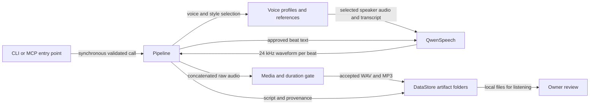
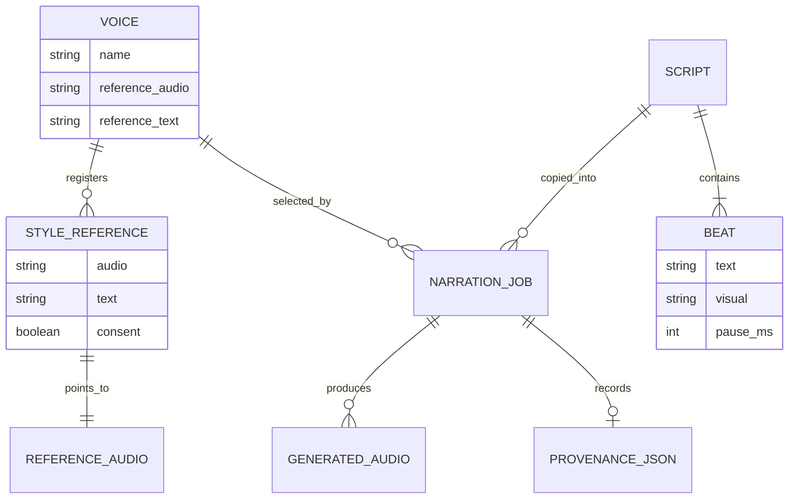

# Expressive Own-Voice Speech Synthesis for YapIt

**A technical review and reproducible model-selection study**

Implementation file/line references below belong to the original research
snapshot. For the maintained folder layout and shared-utility/model-loader
boundaries, use [the developer guide](dev.readme.md).

| Metadata | Value |
|---|---|
| Research date | November 7, 2026 |
| Audience | Software developers evaluating a local personal-voice narration system |
| Owner | Arka |
| Status | Literature and implementation review complete; comparative listening experiment not yet performed |
| Decision scope | English travel narration, preserving Arka's voice, on Windows with an RTX 4070 SUPER eGPU or a CPU-only travelling configuration |
| Evidence policy | Primary papers, official repositories/model cards, and explicitly identified local measurements |

### Abstract

YapIt's existing Qwen3-TTS integration establishes a working voice-cloning baseline, not evidence that Qwen is the best expressive narrator. The central requirement is **controlling delivery while preserving a particular speaker**, rather than generating an arbitrary emotional voice. This review distinguishes numeric prosody controls, emotion-conditioned acoustic models, reference-conditioned synthesis, and models supporting speaker reference plus independent instructions. FastSpeech 2, EmotiVoice, and a specific Emotion-Aware-TTS implementation illuminate useful mechanisms but do not provide equivalent zero-shot own-voice workflows. Current alternatives include VoxCPM2, CosyVoice 3, and IndexTTS 2.5. Their released interfaces better match independently controllable personal-voice narration, with different dependency, licensing, and deployment costs.

**Recommendation:** prioritize **VoxCPM2 and Fun-CosyVoice3-0.5B-2512** for a controlled local comparison against Qwen's neutral and expressive-reference baselines. Treat IndexTTS 2.5 as the explicit emotion/duration-control challenger, conditional on accepting its custom license and isolated Python 3.11 runtime. No model is declared the perceptual winner without listening tests. CPU environment portability and real-time CPU synthesis are separate acceptance questions. [9, 13-23]

## Problem Statement

### 1. Research questions and non-negotiable requirements

The question is not whether a model advertises "emotion." It is whether YapIt can produce **recognizably Arka**, speaking the approved words, with an appropriate and reproducible delivery:

| Research question | Required evidence |
|---|---|
| Can delivery change without changing speaker identity? | Matched speaker reference, contrasting styles, held-out speaker comparisons, and human listening |
| Does "lively travel vlog" sound natural rather than exaggerated? | Style-fit and naturalness ratings on actual travel scripts |
| Can relaxed narration and ASMR-like delivery remain intelligible? | Separate listening and transcription checks; an emotion label alone is insufficient |
| Can an approved transcript fit its video? | Measured duration without omitted words or excessive post-generation stretching |
| Does it run on the actual eGPU and laptop? | Native-Windows installation, real synthesis, memory/latency measurements, and explicit CPU-mode tests |
| Can it be maintained and redistributed appropriately? | Released checkpoints, dependency compatibility, code/weight licenses, and maintenance status |

These are **product requirements and proposed tests**, not claims that every candidate already meets them. There must be no silent replacement of Arka with a stock speaker, silent CPU fallback from an explicitly selected GPU mode, or transcript rewriting to conceal duration failures.

### 2. What is implemented and what was actually observed

The following separates code evidence from quality claims:

| Finding | Evidence and limitation |
|---|---|
| Default synthesis uses `Qwen/Qwen3-TTS-12Hz-1.7B-Base` | `src\speech.py:16,31-73`; reference audio and its transcript construct the clone prompt |
| Audio is generated independently for each script beat | `src\pipeline.py:92-104`; cross-beat expressive continuity is not evaluated |
| Reference-driven style selection is now implemented provisionally | `src\models.py:66-90`; `src\voices.py:168-251`; this selects a different recording, not an emotion-trained model |
| Missing styles and style use with a fine-tuned checkpoint fail explicitly | `src\voices.py:179-190,230-238`; no silent default-reference substitution |
| Style provenance is recorded | `src\pipeline.py:75-90`; the description explicitly requires listening review |
| The existing CPU render is 34.20004 s; the source soundtrack is 28.02792 s | Local `soundfile.info` measurements of `data\generated_audio\7ab3df348947460c84dad25125e1aa14\raw.wav` and `tests\data\arka.ladakhi_marmots.wav` |
| The duration rejection was correct | `34.20004 / 28.02792 = 1.2202`, outside the allowed post-processing factor; mismatch also exceeds 5 s. `src\media.py:97-113` |
| The user found the earlier delivery insufficiently expressive | User listening feedback, **not** a MOS study or controlled comparison |
| Hardware is an NVIDIA GeForce RTX 4070 SUPER, driver 610.88, 12282 MiB VRAM | Local `nvidia-smi --query-gpu=name,driver_version,memory.total --format=csv,noheader` |
| Style-interface regression tests pass | 25 focused tests across `test_voices.py`, `test_pipeline.py`, and `test_interfaces.py`; these verify routing and safety, **not** emotion quality |

No expressive reference recording has yet been supplied for the selected lively-vlog style. No local head-to-head experiment against the shortlisted models has been run. Therefore neither the new style option nor the GPU environment proves expressive quality.

The current training wrapper performs supervised personal-voice adaptation through upstream Qwen scripts. Its records contain `audio`, `text`, and `ref_audio`, not a multi-style emotion-supervision schema. It currently rejects native-Windows training and requires Linux/WSL2 plus CUDA/bfloat16/FlashAttention. Its minimum-data checks are **project guardrails**, not guarantees of good adaptation. `src\training.py:16-99`.

### 3. Terminology and the ambiguous "emovide"

For this investigation:

| Term | Operational meaning |
|---|---|
| Speaker identity | The voice should remain recognizable as Arka, including characteristic timbre and accent |
| Prosody | Timing, pitch contour, stress, rhythm, and pauses |
| Emotion | An affective state such as happiness or sadness; not necessarily the right narration style |
| Delivery style | Communicative manner, such as curious vlog narration or calm conversational explanation |
| Paralinguistic event | A non-word vocal action such as a breath or chuckle |
| Zero-shot cloning | Conditioning a pretrained model on a new speaker reference without optimizing its weights |
| Fine-tuning / SFT | Supervised fine-tuning: updating pretrained weights using paired examples |
| LoRA | Low-rank adaptation: training smaller weight updates instead of updating every original parameter |
| RTF | Real-time factor: synthesis time divided by generated audio duration; below 1 is faster than real time |
| MOS | Mean opinion score: an average human rating collected under a specified listening protocol |

The definitions above establish evaluation axes; they do not imply that a particular architecture perfectly separates them.

**"emovide" is unresolved rather than silently corrected.** Plausible references are **EmotiVoice**, a released engine; **EMOVIE**, a Mandarin emotional-speech paper/dataset and EMSpeech model; or **EmoV-DB**, an emotional speech dataset, not a synthesizer. This review covers all three identities where relevant. EMOVIE reports 9,724 Mandarin samples; the specific English Emotion-Aware-TTS project uses EmoV-DB. These are not interchangeable products. [3-7]

### 4. Research method and scope

The literature was checked against current official repository instructions and released model cards on the research date. Paper publication, repository activity, package version, and model release are distinguished. A README-only update is not treated as a new trained checkpoint. A feature present in one model variant is not attributed automatically to every variant.

The evidence classes throughout this document are:

- **Implemented/measured locally:** source inspection, regression tests, existing audio durations, and hardware detection.
- **Documented by authors:** architectures, exposed APIs, release announcements, model-card resource estimates, and benchmark results.
- **Proposed:** experimental design, acceptance thresholds, workload assumptions, and integration plan.
- **Unknown:** actual Arka voice quality, Indian-English accent preservation, native-Windows feasibility for uninstalled candidates, and their local latency/memory.

This is a scoped decision review, not a systematic survey claiming to exhaust every 2026 TTS release. Repository `main`/`master` documentation is mutable: record exact code and weight revisions before executing the benchmark.

## Implementation

### 1. Architecture taxonomy: why the candidates are not equivalent

An organizing model for the requirement is:

$$
x \sim p_\theta(x \mid y, s, e, \pi, d)
$$

Here `x` is synthesized audio, `y` the approved text, `s` speaker information, `e` requested emotion/delivery, `pi` prosodic context, and `d` a duration constraint. This is an **analytical notation**, not a claim that every backend exposes these five arguments.

The important distinction is between a model that receives one reference containing both identity and delivery, and a model that can condition on identity separately from the requested delivery. Strong conditioning can still leak one attribute into another; "disentangled" in an architecture description is a hypothesis to test perceptually.

#### FastSpeech 2: explicit variance control, not native emotional cloning

FastSpeech 2 encodes phonemes, expands them using predicted duration, adds pitch/energy conditioning, and predicts a mel spectrogram in parallel. A vocoder turns that representation into audio; FastSpeech 2s is the direct-waveform variant. Training uses aligned ground-truth durations, pitch, and energy; inference predicts them. The revised paper uses a continuous wavelet transform for pitch modeling. The widely used `ming024` implementation is a community implementation, not an official Microsoft release. [1, 2]

A simplified description is:

$$
H=\operatorname{Encoder}(y), \qquad
\hat M=\operatorname{Decoder}\bigl(\operatorname{LR}(H,\hat d)+E_p(\hat p)+E_a(\hat a)\bigr)
$$

`LR` is the length regulator; `p` is pitch and `a` acoustic energy. The equation abstracts implementation ordering. Numeric scaling changes timing, pitch, or energy, but does not establish a learned "curious travel narrator" control. The original work leaves emotion/style/speaker extensions to future work. Thus comparing original FastSpeech 2 directly to pretrained own-voice foundation models without adding speaker/style training would be an unequal experiment. [1]

#### Emotion-conditioned FastSpeech variants: labels must match the learned speech

The specific `ionut-cmd/Emotion-Aware-TTS` project pairs a modified FastSpeech 2 with text-emotion analysis. Its acoustic model adds speaker and emotion embeddings, while its classifier uses RoBERTa trained on GoEmotions. The speech training uses four English EmoV-DB speakers and five categories: amused, anger, disgust, neutral, and sleepiness. Manual emotion-ID inference is also exposed. This is a real trained research system, not merely a wrapper pretending to add emotion. [6, 7]

However, four trained speaker IDs are not arbitrary reference-audio cloning. The trained label set also does not establish ASMR or lively-vlog controllability. The paper reports timing and waveform RMSE, not a human naturalness/emotion study or an own-voice identity benchmark. Its cross-system speed table involves different GPUs, so it cannot determine the fastest candidate here. [6]

**Engineering inference:** text sentiment is not the same as desired delivery. A neutral statement about marmots may appropriately be narrated with curiosity. Prefer explicit user style plus contextual intent over automatically forcing a text classifier's label.

#### EmotiVoice: prompt-conditioned acoustic generation with a closed speaker table

EmotiVoice's released path combines a speaker-ID embedding with BERT-derived style/content embeddings and acoustic predictors, using a PromptTTS-related model and joint acoustic/vocoder inference. Its advertised large voice inventory is a lookup table of known speakers, not a reference encoder for any new speaker. An own-voice recipe exists, but it involves training on paired personal recordings; emotionally expressive personal output needs appropriate emotional examples. [3, 4]

The observed September 3, 2026 repository update changed Chinese documentation, not model code. The roadmap's next-model and longer-text items remain unchecked. Its historical Python 3.8 setup and checkpoint-license uncertainty increase integration work. EmotiVoice remains a useful **prompt-control and adaptation baseline**, not the shortest path to zero-shot Arka narration. [3-5]

#### Codec-language models: expressive information and API availability are different

A codec-language model generates speech codes autoregressively:

$$
p(z\mid c)=\prod_t p(z_t\mid z_{<t},c), \qquad x=\operatorname{Decode}(z)
$$

`c` represents the available conditioning. This factorization explains why generation has sequential cost and why conditioning matters; it is not a speed comparison.

Qwen3-TTS uses discrete multi-codebook speech modeling with its 12 Hz tokenizer. **YapIt's Base checkpoint provides reference cloning; it does not expose the 1.7B CustomVoice instruction workflow.** The official released-model table also does not advertise instruction control for the 0.6B models. CustomVoice's stock speakers and VoiceDesign's newly created persona do not automatically satisfy "keep Arka." [8-10]

Using an expressive recording of Arka as the Base reference is a sensible low-cost experiment. It transfers an example, rather than separately specifying identity and emotion. Temperature/top-p changes stochastic sampling, not a calibrated emotion axis. Qwen is worth retaining as the working comparator, not defending as an already established winner. `src\speech.py:63-92`; [9].

#### Hybrid and continuous-latent models: finer control with different costs

CosyVoice combines language-model speech-token generation with chunk-aware flow matching. Its third-generation paper improves the tokenizer using supervision including recognition, emotion, language, audio events, and speaker analysis. The released instruction interface can receive both a speaker recording and an instruction. However, the May 2025 paper discusses scaling to **1.5B**, whereas the current public `2512` checkpoint selected here is **0.5B**. Paper-scale measurements must not be relabeled as measurements of that checkpoint. [21-23]

IndexTTS 2.5 separates text-to-semantic generation from semantic-to-mel rendering and a vocoder. Its report describes reducing semantic frame rate from 50 to 25 Hz, replacing the semantic-to-mel backbone with Zipformer, and applying GRPO post-training. GRPO is a reinforcement-learning method comparing groups of sampled outputs. The released interface provides separate speaker/emotion references, an eight-dimensional emotion vector, optional text-to-emotion conversion, and a duration factor. These controls directly address the requirements but do not prove perfect identity/emotion separation. [16-20]

VoxCPM2 generates continuous speech-latent patches with hierarchical semantic/acoustic language modeling and local diffusion. "Tokenizer-free" means no **external discrete speech tokenizer**; its paper still includes an internal finite-scalar-quantization bottleneck. Separate reference conditioning and style-guided cloning are exposed in one model. Its 16 kHz reference encoding and 48 kHz decoding do not imply that an old recording gains missing original information or that higher sample rate proves more natural speech. [13-15]

Flow matching learns a velocity field for transforming noise into conditioned speech representations. Conceptually:

$$
\mathcal L_{\mathrm{FM}} =
\mathbb E\left[\|v_\theta(x_t,t,c)-u_t\|^2\right],
\qquad \frac{dx_t}{dt}=v_\theta(x_t,t,c).
$$

`u_t` is the target training velocity. This explains why iterative sampling steps introduce a quality/cost lever. A diffusion or flow model is not automatically more emotional than a codec model; the conditioning, data, and inference path must support the requested behavior. [15, 30]

#### Style diffusion and reference continuation

StyleTTS 2 samples a latent style through diffusion and uses a pretrained speech-language-model discriminator for training. Its multispeaker model supports reference-based zero-shot adaptation, with a documented fine-tuning route. Its strong published listening results are dataset-specific, not evidence on Arka's recordings. Deployment involves phonemization and package/license choices that deserve explicit review. [28, 29]

F5-TTS uses conditional flow matching with a diffusion Transformer and reference audio/text. The latest base checkpoint advertised by its official README is **F5-TTS v1**, released March 12, 2025. Multi-style inference selects different references; that is not automatically independent speaker/emotion control. Its permissive code license does **not** make the pretrained weights commercially unrestricted: those are CC-BY-NC. [30, 31]

### 2. Emotion taxonomy, delivery style, and content context

**Research correction:** the ten labels initially proposed for YapIt (`curious`,
`awe`, `clear-explainer`, and so on) are product presets, not a published universal
emotion taxonomy. They must not be advertised as native categories trained into
every candidate. The relevant research instead distinguishes affective labels,
acoustic attributes, free-form style descriptions, and contextual intent.

| Source | What it actually uses | Consequence for YapIt |
|---|---|---|
| IndexTTS2/2.5 public emotion-vector interface | Eight ordered dimensions: happy, angry, sad, afraid, disgusted, melancholic, surprised, calm | A directly documented bounded control interface; there is no native `travel`, `product`, `curious`, or `awe` vector dimension [17] |
| EmoV-DB and the reviewed Emotion-Aware-TTS project | Neutral, sleepiness, anger, disgust, amused | A corpus-specific set, not a complete creator taxonomy; sleepy is not the desired default for calm narration [6, 7] |
| CosyVoice3 official instruction examples | Happy, sad, angry instructions; separate very-soft/loud voice and slow/fast speech instructions, plus dialect/style examples | The public examples distinguish emotion from acoustic delivery. They are examples, not proof of arbitrary English-style generalization [35] |
| VoxCPM2 public cloning controls | Natural-language instructions for emotion, speed, and style, independent of the reference used for timbre | A free-form instruction interface rather than a public closed emotion-ID list; performance must be tested for each requested combination [36] |
| InstructTTSEval | Acoustic-Parameter Specification, Descriptive-Style Directive, and Role-Play/context; its paper organizes 12 features into several tiers | Evidence for evaluating separate low-level controls, high-level descriptions, and scenario adaptation, not for declaring a fixed set of ten emotions [33, 34] |

InstructTTSEval is an evaluation benchmark, **not a training-label specification
for every model evaluated on it**. Its expressive references include film/TV
material, which is not automatically representative of natural personal vlogs.
Its automatic evaluation uses external model judges; YapIt's private audio must
not be uploaded merely to reproduce that judge. Local listening and local metrics
remain the selection method. [33]

The 2026 Emotional-Context-Speech work further supplies conversational context,
personal experience, open-vocabulary emotion labels, and paralinguistic
descriptions, with authors reporting benefits from context-aware synthesis. It
supports the principle that isolated sentence labels omit relevant information;
it does **not** prove that adding a `travel` flag improves every shortlisted model
or establish performance on Arka's recordings. [37]

#### Proposed control model for `add_emotion`

Keep the underlying concepts separate, with friendly presets composing them:

| Layer | Proposed representation | Interpretation |
|---|---|---|
| Output identity | `profile`, default `arka` | The enrolled voice, not a filename-only label |
| Affect | `emotion_type` | Backend-independent requested emotion, mapped only to validated backend controls |
| Delivery | Conversational, storytelling, explanatory, cinematic | How the words are communicated; these are proposed product categories |
| Vocal mode | Spoken, soft-spoken, whisper | Whispering must be separately validated; it is not a synonym for calm/sleepy |
| Expressive strength | Subtle by default; moderate optional | Product-level settings, not universal numerical intensity calibration |
| Context | Optional domain, content subtype, audience/intent, pronunciation hints | Guidance for phrasing and emphasis, never permission to rewrite facts |

A practical affect vocabulary can begin with **neutral, happy, calm, sad, and
surprised**, and expose angry/fearful/disgusted/melancholic only where the backend
passes explicit capability tests. This is a **proposed scoped vocabulary** assembled
from the documented interfaces, not a claim that all five initial labels are
already available in YapIt's current Qwen Base path. `neutral` need not correspond
to a vector dimension: its backend mapping may mean no emotion override.

Keep creator presets as a separate convenience layer:

| Proposed preset | Requested intent, not a scientific equivalence | Useful context |
|---|---|---|
| `lively-vlog` | Curious, friendly exploration with varied emphasis and restrained energy | Travel experiences, discovering a place or trying a feature |
| `relaxed-travel` | Calm, warm, unhurried conversation without flattening intonation | Slow travel and relaxing commentary |
| `cinematic-landscape` | Quiet wonder, space between phrases, non-theatrical delivery | Landscape reveals and cinematic scenes |
| `reflective-journey` | Thoughtful personal storytelling, without automatically making it sad | Memories and meaningful travel experiences |
| `clear-itinerary` | Neutral/helpful explanation with clear emphasis on days, times, and logistics | Itineraries and practical travel advice |
| `energetic-review` | Credible enthusiasm with articulate feature/benefit emphasis | Positive tech, makeup, kitchen, and household reviews |
| `balanced-review` | Measured explanation of strengths and limitations; no forced positivity | Comparisons, reservations, recommendations |
| `asmr-landscape` | Calm, intimate delivery with explicitly selected soft-spoken/whisper mode | Relaxing landscape ASMR commentary |

These are **proposed presets pending listening validation**. In particular, do
not implement `awe` or curiosity by inventing untested emotion-vector mixtures.
Use an appropriate instruction/reference path and evaluate the result. Preserve
existing reference-labeled presets: their metadata alone cannot distinguish a
soft-spoken reference from an actual whispered one.

#### Is travel/product context required?

**No: an explicit domain should be optional.** This is the recommended product
design. The approved transcript already supplies vocabulary; optional context
can make intended delivery less ambiguous:

- Travel experience: conversational discovery and personal emphasis.
- Itinerary: intelligible names, numbers, durations, and practical instructions.
- Cinematic landscape: lower energy and considered pauses, without compulsory whisper.
- Product review/demo: articulate feature names and contrasts, without compulsory excitement.
- Makeup/food/household use: relatable demonstrations; domain alone must not dictate a sales voice.

Domain, emotion, and energy must not be locked together. A travel itinerary can
be brisk and clear; a product review can be calm or skeptical. When no domain is
supplied, use generic instructions rather than treating an inferred domain as an
authoritative classification. Pronunciation hints can guide approved words but
must not silently change place names, brands, specifications, or claims.

#### Agreed workflow and remaining implementation gate

The owner selected **one-step unreviewed drafts for audio-only inputs** and
**natural timing by default**. Proposed behavior:

```text
add_emotion AUDIO --emotion-type calm [--transcript PATH]
                 [--profile arka] [--context travel-itinerary]
                 [--vocal-mode spoken|soft-spoken|whisper]
```

This command is **not implemented**. Audio-only mode would run local ASR then
regenerate, clearly labeling both transcript and audio as unreviewed. Supplied
transcripts would be authoritative. Standalone Rescript continues to produce
review-required transcripts without generating audio. No automatic rewriting,
source truncation, music/ambience preservation, or exact pause reconstruction is
implied. Matching source duration would be an explicit mode with existing
stretching/correctness gates.

The `arka` default chooses the output voice. If a deliberate different profile is
selected, the system must not describe the result as preserving a different source
speaker. Source/profile consent and identity need explicit validation.

Backend feasibility remains a gate. Qwen Base cannot be given arbitrary emotion
instructions merely by adding a flag. VoxCPM2's documented controllable-cloning
mode is the first prototype route; its guide warns that Hi-Fi mode ignores the
control instruction, so the adapter must not accidentally select that mode.
Voice identity and style adherence still require local tests. [9, 36]

### 3. Released-capability and decision matrix

**Documented support is not measured quality.** "Training required" describes the path to a new speaker, not a guarantee that sufficient personal data exists.

| Candidate actually reviewed | Personal-voice path | Emotion/delivery mechanism | Role and principal tradeoff |
|---|---|---|---|
| FastSpeech 2, paper v8; community implementation | Train/adapt a speaker-capable implementation | Numeric duration/pitch/energy; emotional extension needs training | Architectural baseline, not an equivalent zero-shot product [1, 2] |
| EmotiVoice, current released repository | Own-data fine-tuning; pretrained speaker-ID inventory | Text prompt embedding | Useful explicit-style baseline; older stack, personal expressive data, unverified weight terms [3-5] |
| EMOVIE / EMSpeech | Mandarin research system, not verified English own-voice tooling | Text-predicted emotion | Disambiguation and historical research; not selected [6, 7] |
| `ionut-cmd/Emotion-Aware-TTS` | Four trained English speakers; new speaker adaptation not documented | Five trained emotion categories, manual or classifier-driven | Educational/research baseline; not arbitrary voice cloning [6, 7] |
| Qwen3-TTS 12Hz 1.7B Base | Speaker audio plus exact transcript | Reference-conditioned delivery; no native Base instruction interface | Implemented comparator; weakest independent-control fit among the shortlist [9, 10] |
| Qwen3-TTS 1.7B CustomVoice / VoiceDesign | Stock speaker or designed persona; own-speaker training is a separate route | Instructions | Not a drop-in Arka-preserving substitution [9] |
| VoxCPM2, 2B | Reference cloning or continuation with reference transcript | Style-guided cloning in released API | **Priority challenger:** requirement fit plus Apache-2.0 weights; higher memory and stochastic-style risk [13-15] |
| Fun-CosyVoice3-0.5B-2512 | Zero-shot reference cloning | Instruction plus speaker reference; vocal-event controls | **Priority alternative:** smaller released model; Windows dependencies and actual English instruction fidelity untested [21-23] |
| IndexTTS 2.5 | Separate speaker reference | Separate emotion reference/vector/text; native duration factor | Strongest explicit controls; custom license and incompatible Python pins require isolation [16-20] |
| StyleTTS 2, multispeaker | Reference adaptation or fine-tuning | Style diffusion and reference blending | Valuable naturalness baseline; greater integration/training complexity [28, 29] |
| F5-TTS v1 Base | Reference audio/text | Reference-selected styles, flow sampling | Useful reference-continuation baseline; pretrained weight restriction [30, 31] |
| Chatterbox V3 / Turbo / Nano | Reference cloning | Variant-specific controls and vocal tags | Nano is a CPU experiment, not a proven travelling solution; upstream retirement risk [25-27] |
| OmniVoice, released repository | Reference cloning; separate voice-design mode | Documented attributes and vocal-event syntax | Horizon candidate; the reviewed examples do not establish arbitrary emotion instructions combined with cloning [32] |

**Freshness checks that materially change the decision:**

- Qwen's official release announcement is January 22, 2026; its Base and instruction-capable variants are distinct. [9]
- VoxCPM2's repository announces an **April 2026** release; its technical report was submitted **June 5, 2026**. These are different events, not a contradictory release date. [14, 15]
- IndexTTS **2.5**, not 2, is the current reviewed release, announced **August 10, 2026**; the paper's latest revision is **August 11, 2026**. The older IndexTTS 2 README said precise-duration control was not enabled in that release. [16, 17]
- CosyVoice's reviewed public recommendation is the **December 2025 `2512`** base/RL family. The base checkpoint is selected first; RL is a separate ablation, not assumed better on speaker identity. [22, 23]
- Chatterbox's current repository says it became **retired, unmaintained research in August 2026**. Its model card and parts of the README retain older promotional material. Do not infer current support or a commercial service from those stale paragraphs. [25, 26]

### 3. Verified control interfaces and integration hazards

The following are abbreviated API shapes, **not code already integrated into YapIt**:

```python
# VoxCPM2: reference identity with separately supplied style guidance.
model.generate(
    text="(warm, curious, conversational delivery)" + approved_text,
    reference_wav_path=reference_audio,
    cfg_value=2.0,
    inference_timesteps=10,
    seed=42,
)

# CosyVoice3: the released example passes instruction and speaker recording.
model.inference_instruct2(
    approved_text,
    "You are a helpful assistant. " + instruction + "<|endofprompt|>",
    reference_audio,
    stream=False,
)

# IndexTTS2.5: speaker and emotion recordings are distinct inputs.
tts.infer(
    spk_audio_prompt=reference_audio,
    emo_audio_prompt=emotion_audio,
    emo_alpha=0.7,
    text=approved_text,
    lang="EN",
    output_path=generated_audio_path,
)
```

Sources: [14, 17, 22]. Parameter values illustrate an initial configuration, not tuned recommendations or achieved quality.

VoxCPM places instructions in a model-specific text prefix. YapIt must preserve the original `Script.beats[].text` and compile control metadata separately inside the backend. Explicitly test that instructions are **not spoken**. Compare its controllable-cloning mode against continuation mode rather than assuming both maximize identity and style simultaneously. [13, 14]

CosyVoice examples demonstrate the combined interface, including dialect/speed instructions; their existence does not prove that an English "curious vlog" instruction is followed reliably. Verify the selected checkpoint and instruction syntax locally. [22, 23]

IndexTTS 2.5's text-emotion helper is optional and requires `use_qwen_emo=True` when constructing the model. Its `duration_factor` range is 0.5-2.0, with values above 1 slowing speech. It is a relative duration control, not a guarantee of exact video alignment. `use_random=True` is documented as reducing cloning fidelity. Use deterministic conditioning first and record any extra helper-model memory. [17, 18]

Chatterbox Turbo/Nano have an especially important trap: their `generate` method accepts `exaggeration` and `cfg_weight`, but logs that these controls are unsupported and ignored. Their reference preparation also requires **more than five seconds** of audio. Thus a three-second YapIt reference cannot be reused blindly, and original Chatterbox's expressiveness guidance cannot be transferred to Nano by copying argument names. [27]

### 4. Windows, eGPU, CPU, and licensing feasibility

| Candidate | Verified upstream requirement or estimate | YapIt-specific implication |
|---|---|---|
| Qwen baseline | Upstream recommends isolated Python 3.12; current code supports CPU and CUDA selection [9] | Existing integration works; new CPU/GPU environments establish runtime portability, not model quality |
| VoxCPM2 | Package metadata requires Python >=3.10, Torch >=2.5; README guidance is narrower than that metadata. Model card estimates approximately 8 GB VRAM [13, 14] | Plausible on the 12 GB-class eGPU, **unmeasured**; isolate and resolve its Gradio/TorchCodec dependencies rather than modifying Qwen's environment |
| CosyVoice3 | Official setup uses Python 3.10; optional `ttsfrd` example wheel is Linux-specific, with a documented alternative frontend [22, 23] | Use an isolated runtime and test native Windows; do not require the optional Linux wheel or claim WSL2 is already validated |
| IndexTTS2.5 | Manifest requires Python >=3.10,<3.12, Torch 2.8, Transformers 4.52.1; model card estimates roughly 6 GB inference VRAM [18, 19] | Cannot install into YapIt's current Python 3.12/Qwen stack as-is; Python 3.11 worker is the straightforward candidate |
| Chatterbox Nano | Model card targets CPU; tested upstream environment is Python 3.11/Debian 11; public checkpoint and `nano=True` API exist [26, 27] | Worth a travelling-mode spike, but native-Windows latency, identity, and dependencies remain unmeasured |
| EmotiVoice / Emotion-Aware-TTS | Older acoustic-model toolchains and limited published deployment evidence [3-7] | Higher adaptation/setup cost; not justified before the zero-shot shortlist |

VoxCPM2's reported 4090 RTF around 0.30 and Nano's reported three-times-real-time eight-core result are **author claims on other hardware**. They are not forecasts for this eGPU or laptop. Similarly, inference memory estimates do not establish training feasibility. [13, 26]

**Proposed memory policy:** load only one synthesis model at a time and unload/offload ASR before synthesis. For scale intuition only, 2 billion BF16 parameters occupy approximately `2e9 * 2 = 4e9` bytes before decoder models, activations, caches, CUDA overhead, and display use. This lower bound is not a peak-VRAM estimate. A 12 GB-class card does not justify keeping every candidate resident.

**License gate, not legal advice:**

| Artifact | Verified status | Decision consequence |
|---|---|---|
| Qwen Base weights | Apache-2.0 model-card metadata [10] | Favorable starting point; keep required notices and review included dependencies |
| VoxCPM2 code/weights | Apache-2.0 repository/model card [13, 14] | Favorable for a maintainable backend; consent and output disclosure remain product requirements |
| CosyVoice3 `2512` weights | Apache-2.0 model-card metadata [23] | Favorable; review ancillary components independently |
| IndexTTS2.5 | Custom Bilibili model agreement, not MIT/Apache [18, 20] | Review before adoption or redistribution; includes scale thresholds, downstream obligations, and restrictions on improving other AI models |
| EmotiVoice | Apache-2.0 code; downloaded checkpoint terms not independently verified [3, 4] | Do not claim blanket commercial clearance |
| Emotion-Aware-TTS | MIT repository; checkpoint/data terms not independently established [6, 7] | Research use requires resolving actual artifact terms |
| StyleTTS2 | MIT code; additional pretrained-model consent/disclosure instructions; some inference packaging involves GPL dependencies [29] | Evaluate exact package and weights rather than calling the entire stack uniformly MIT |
| F5-TTS | MIT code, CC-BY-NC pretrained weights [31] | Commercial deployment needs a different licensed-weight strategy |
| Chatterbox Nano | MIT model-card metadata; archived research support status [25, 26] | Permissive licensing does not eliminate maintenance cost |

The IndexTTS2.5 card links an agreement whose definition still names `bilibili indextts2`. Record the actual downloaded agreement and seek clarification if redistribution or derivative-training scope matters; do not infer unrestricted permissions from a repository description. [18, 20]

### 5. Recommendation and explicit tradeoffs

**VoxCPM2 is the first technical challenger**, because the released controllable-cloning interface directly combines speaker reference and style instructions, and its weight license avoids IndexTTS's custom restrictions. The costs are a larger model, stochastic style fidelity, output-rate conversion, and an untested Windows dependency stack. Its advertised memory estimate makes a local experiment reasonable, not guaranteed. [13-15]

**CosyVoice3 `2512` is the second challenger**, because its released instruction-plus-reference path provides another way to satisfy the same requirement with a smaller model. The costs are frontend/dependency integration and uncertainty about English style adherence; do not extrapolate the 1.5B paper or streaming figures to the released 0.5B model on this machine. [21-23]

**IndexTTS2.5 is the specialist challenger** if exact control is prioritized enough to justify license review and a separate interpreter. Its emotion references/vectors and duration factor are more explicit than Qwen Base's single-reference path. A speaker-preserving English lively/relaxed result still needs verification. [16-20]

**Retain Qwen as a reversible baseline.** Compare the same enrolled voice with neutral and genuinely expressive personal references before discarding a working integration. If the expressive-reference baseline satisfies the owner, avoiding another backend is a legitimate simplicity win. It is not a reason to skip the comparison.

For CPU travel, first retain the existing CPU-capable Qwen mode with honest latency reporting. Evaluate Nano separately only if measured latency is unacceptable; model switching can change identity/style and must never be invisible. Do not promise that the GPU quality winner will also be the CPU speed winner.

### 6. Architecture and artifact model

The diagram below shows the **current implemented narration route**, not fictitious deployed candidate services. Candidate adapters are proposed in the task breakdown.



Evidence: `src\speech.py:19-95`; `src\pipeline.py:29-166`; `src\voices.py:226-251`; `src\storage.py:41-171`; `src\media.py:97-131`.

**CLI/MCP entry point.** Accepts validated local inputs and style selection; calls Pipeline synchronously through Python. MCP paths are confined to configured workspace/data roots. It must not bypass missing-style or consent validation. `src\cli.py`; `src\server.py`; `src\storage.py:90-108`.

**Pipeline.** Coordinates voice selection, unchanged script text, per-beat generation, pauses, duration fitting, and provenance. Its communication is synchronous Python calls to voice selection, speech, and media helpers, followed by local-file writes. `src\pipeline.py:46-155`.

**Voice profiles and references.** JSON metadata and local recordings identify the speaker and optional human-labeled styles. Selection supplies the reference directory and transcript to QwenSpeech; registration stores raw/prepared audio plus a transcript sidecar without training. `src\voices.py:168-251`.

**QwenSpeech.** Lazily loads one model, builds the reference prompt, and returns validated/resampled NumPy audio. Python calls to Qwen are synchronous; its lock protects that backend instance, **not every independent process using the GPU**. `src\speech.py:23-95`.

**Media and duration gate.** Runs local media tools synchronously and checks fitted and encoded durations. This is a correctness barrier, not a shortcut for forcing all output into the requested runtime. `src\media.py:22-33,97-131`; `src\pipeline.py:106-118`.

**DataStore artifact folders.** Stores raw/reference recordings in `data\audio`, text artifacts in `data\transcripts`, and synthesized audio in `data\generated_audio`. New generated artifacts are flat, with `<profile>.<source>` names and numeric duplicate suffixes; operational metadata is flat under `workspace\outputs`. Existing voice/enrollment/import storage remains structured and old artifacts are not migrated. Communication is local filesystem I/O; there is no selected distributed database or broker. `src\storage.py:41-171`.

**Owner review.** The human listens to local files and judges voice, delivery, and words. Automated routing/signal checks cannot supply this judgment; the review step is a required product gate, not an existing automated service.

The ER diagram is a **logical model of existing Pydantic objects and file artifacts**, not a relational schema or claim of database constraints:



Evidence: `src\models.py:26-54,66-90`; `src\pipeline.py:66-90,105-155`; `src\voices.py:196-222`. Here a narration job means a scripted synthesis attempt that reached artifact creation; prompt-only jobs and earlier validation failures are outside this diagram. Failed synthesis can produce zero final audio files.

**Storage/CAP applicability.** CAP describes consistency versus availability under partitions in distributed storage. This local single-machine design selects neither a distributed database nor a message queue, so labeling its directories "CP" or "AP" would be misleading. No DB/queue comparison or CAP classification is needed. The relevant file-storage tradeoffs are durability, atomic writes, path confinement, backup, and concurrent access.

### 7. Scale, RPS, backpressure, and single points of failure

**Planning estimates, not observed usage:** one owner, one active synthesis job, ten 45-second narrations per day, and ten 30-second imported recordings per day. Using mono 24 kHz PCM16:

```text
One 45 s waveform = 45 * 24,000 * 2 = 2.16 MB
Three generated WAV versions * 10 jobs = 64.8 MB/day
Ten 30 s raw recordings = 10 * 30 * 24,000 * 2 = 14.4 MB/day
Combined illustrative growth = 79.2 MB/day ~= 2.38 GB per 30 days
```

This excludes MP3, video, caches, alternate candidate outputs, source recordings with other formats, and model checkpoints. Canonical folder locations are implemented; the volume is an assumption.

For an assumed interactive burst of **one submission per minute**:

```text
Job arrival rate lambda = 1/60 = 0.0167 requests/s
Two logical input-file reads/job ~= 0.033 reads/s
Approximately ten artifact writes/job ~= 0.167 writes/s
```

These read/write counts simplify Pipeline's operations and exclude model-loading I/O. Storage RPS is not the expected bottleneck. For output duration `D` and measured warm RTF `r`, service capacity is approximately `mu = 1/(r*D)`. At hypothetical `D=45, r=1`, utilization is `lambda/mu = 0.75`; at hypothetical `r=4`, utilization is `3`, so an unbounded backlog would grow. Neither RTF is a local result.

**Proposed backpressure:** admit one GPU synthesis process at a time; reject or explicitly wait on additional submissions with a bounded pending count. Cancel between beats, bound worker timeouts, and retain failure metadata. A shared process/GPU admission mechanism would be new work: the existing per-object Qwen lock is insufficient across CLI/MCP processes. Run ASR and synthesis sequentially on the eGPU to avoid memory contention.

| Single point of failure | Consequence | Proposed mitigation |
|---|---|---|
| Detachable eGPU/driver | Mid-job CUDA failure or unavailable GPU mode | Preflight and explicit failure; restart only with owner-selected CPU mode, not hidden fallback |
| Laptop disk | Loss of recordings, transcripts, and outputs | Back up canonical data/profile folders; preserve raw originals and checksums |
| Model download/cache | Offline travel or cold start cannot load weights | Pin and pre-cache selected weights; test offline startup |
| Single synthesis worker | Crash blocks a job | Timeouts, failed-job metadata, and bounded explicit restart |
| Owner review | No validated expressive reference or listening decision | Keep output marked unreviewed; do not substitute automated emotion scores for consent/quality approval |

## Success Criteria

### 1. Reproducible local experiment

**Prerequisite:** obtain an owner-confirmed expressive recording with its exact spoken transcript. Do not manufacture a style reference from tones, another speaker, or an unverified soundtrack. Use a common **6-10 second** high-quality speaker excerpt for the principal experiment, subject to each model's documented requirements; this also satisfies Nano's more-than-five-second requirement. Keep longer style references as a separate ablation. [9, 27]; `src\voices.py:168-251`.

Proposed primary conditions:

| Condition | Purpose |
|---|---|
| Qwen Base + default reference | Existing-model control |
| Qwen Base + matched expressive reference | Isolates the effect of reference delivery |
| VoxCPM2 + same identity reference + requested style | Tests independently instructed cloning |
| CosyVoice3 `2512` + same identity reference + requested style | Tests a second instruction-capable architecture |

Add IndexTTS2.5 after its license/runtime gate. Keep equivalent information available where interfaces differ: all backends receive the same approved text and reference recordings, but some consume exact reference transcripts and others do not. Record this asymmetry rather than pretending identical API arguments.

Use **12 held-out scripts x 3 styles x 2 reproducible runs x 4 conditions = 288 renders**. The three styles are lively-vlog, relaxed-travel, and ASMR-like soft delivery. Include the corrected marmot script, unfamiliar geographic names, numbers, punctuation, a firm wildlife-advice sentence, and multi-beat continuity cases. At an assumed average 20 seconds, this is `288 * 20 = 5,760 s = 96 min` of generated audio, not 96 minutes of compute.

The marmot fixture is useful regression data, but it is not automatically a fully verified gold transcript: the earlier lake-name transcription remains unconfirmed. Preserve "The Ladakhi Marmot" and "burrows to greet you," and have the owner verify other proper names before scoring them as ASR errors.

Begin with one script/style per backend for installation and memory feasibility. Do not launch all 288 jobs before confirming references, licenses, and basic output validity.

### 2. Controls, metrics, and analysis

**Freeze the experiment:** code/model revisions, environment lock or package inventory, reference checksums, exact text, style wording, chunk boundaries, supported seed settings, dtype/device, and decoder parameters. Pin revisions before execution. A fixed seed is not a guarantee of bit-identical output across different hardware or library versions.

Perform two distinct evaluations:

| Evaluation | What it isolates |
|---|---|
| Matched per-beat generation | Backend quality under YapIt's current chunking pattern |
| Native paragraph/context generation ablation | Whether chunking loses continuity; keep timing and spoken-text checks equally strict |

Use fixed initial decoding settings rather than giving one model unlimited cherry-picked retries. Publish failures and first-pass success rates. Tune on a separate development set; do not tune and score the same held-out scripts.

| Dimension | Proposed measurement | Interpretation limits |
|---|---|---|
| Text fidelity | WER/CER with a fixed local ASR model, plus manual proper-name verification | ASR bias and accent errors require listening; never use the uncertain source ASR output as unquestioned truth |
| Identity | Fixed speaker-embedding cosine similarity against several held-out real Arka clips; owner same-speaker judgment | Embedding scores are evaluator-dependent, not a universal identity threshold |
| Style fit | Blind human 1-5 ratings and preference comparisons | Classifier emotion accuracy alone does not establish desired narration |
| Naturalness | Separate 1-5 listening ratings | Do not conflate louder or more exaggerated with better |
| Intelligibility | Manual words and independent transcription, especially soft speech | Low energy or pitchless whisper can undermine automated metrics |
| Continuity | Boundary clicks, repeated words, abrupt pitch/energy shifts, inconsistent speaker/style | Single short demos cannot establish long-form quality |
| Duration | Raw/final length, approved-word completeness, tempo factor, per-beat timings | Native duration controls do not excuse content omission |
| Performance | Cold/warm latency, synchronized CUDA timing, RTF, process RAM, peak allocated/reserved VRAM, failures | Other vendors' GPU results are not local measurements |

The CosyVoice paper uses ASR error rates and WavLM embedding similarity, illustrating useful objective axes, not sufficient emotion-quality evidence. [21]

For listening, randomize anonymized conditions, include real-recording anchors, and loudness-match comparison copies without altering the originals or introducing clipping. LUFS is a perceptual loudness measure useful for matching playback levels. Record normalization parameters separately. Use at least three listeners where possible, including the owner for personal identity; if only the owner participates, report this explicitly as a small personal preference study.

Analyze **paired per-script/style differences**, not an average that hides catastrophic speaker drift. Report distributions, confidence intervals obtained by resampling script groups, all failure counts, and first-pass versus retry-assisted quality. Two runs on the same text are not independent evidence equivalent to two different scripts.

### 3. Proposed decision gates

These thresholds are **engineering targets to approve before testing**, not published model performance:

| Gate | Proposed acceptance |
|---|---|
| Safety/privacy | Local audio stays local; consent recorded; paths confined; generated content labeled |
| Words and controls | No omitted safety advice, invented phrases, or spoken instruction tokens; proper names reviewed |
| Signal validity | No empty/nonfinite/silent output; no unacceptable clipping or boundary artifacts |
| Speaker identity | Owner accepts every released clip as recognizably their voice; embedding distributions do not show systematic degradation versus accepted baseline |
| Style improvement | Median blinded style-fit improvement of at least 0.5/5 over default Qwen, with median naturalness >=4/5 and no material identity loss |
| Timing | Existing +/-5 s and 0.90-1.10 post-stretch gates remain; exact video synchronization, if requested, needs a separately agreed tighter tolerance |
| GPU operation | Actual CUDA synthesis completes within available VRAM; no hidden CPU fallback; record a proposed warm RTF target <=1 separately from quality gates |
| CPU travel | Offline CPU synthesis succeeds without the eGPU; report latency; real-time CPU capability requires its own measured acceptance |
| Operational quality | Missing style, invalid input, failed worker, and GPU disconnection produce explicit errors and preserved job provenance |

A candidate failing identity or text fidelity cannot win by speed or emotion ratings. If no challenger clearly improves the accepted expressive-reference Qwen baseline, retain the simpler implementation.

### 4. Results not yet available and threats to validity

The benchmark-results table is intentionally not populated. Missing evidence includes actual expressive reference recordings, native-Windows installation/synthesis for challengers, local memory/RTF, blind listener ratings, Indian-English accent retention, and CPU model quality.

Material confounders include reference recording quality, unequal conditioning interfaces, loudness, chunk boundaries, model-specific frontend pronunciation, stochastic retries, training/test overlap, and automated evaluators' accent/style biases. The present 25 passing style tests do not resolve any of those perceptual questions.

## Task Breakdown

Each item is sized as an approximately **one-to-two-week deliverable**, not a request to launch training or all candidates immediately. Arka owns approval of recordings, target delivery, and final listening judgments; engineering implements the experiment and reversible adapters.

| Work item | Dependency | Deliverable and exit condition |
|---|---|---|
| 1. Freeze reference and evaluation corpus | None | Consent-confirmed default/expressive recordings, exact transcripts, proper-name review, held-out scripts, checksums, and pre-agreed listening rubric |
| 2. Validate isolated runtimes | None; recordings needed for final synthesis smoke | Finish existing CPU/GPU baseline modes; pre-cache weights; verify offline CPU, actual CUDA synthesis, `pip check`, eGPU-unavailable behavior; resolve challenger dependency/license gates |
| 3. Prototype shortlisted adapters | 1 and 2 | VoxCPM2/CosyVoice3 experimental backends preserve script text, resample to YapIt's 24 kHz contract, retain canonical artifacts, reject invalid output, and record backend/control provenance |
| 4. Execute and analyze the benchmark | 3 | Reproducible renders and anonymized listening copies; paired analysis of identity/style/words/timing/performance; no cherry-picked demo claims |
| 5. Promote the winner reversibly | 4 | Explicit backend selection with a preserved baseline, documented CPU/GPU behavior, bounded execution, focused regression tests, and owner-approved marmot narration |
| 6. Add specialist control or adaptation only if justified | 4; Index license approval if selected | IndexTTS2.5 control ablation, or style-labeled personal fine-tuning with held-out evaluation; proceed only when a documented failure motivates the extra complexity |

**Proposed adapter boundary:** preserve `SpeechBackend.synthesize(text) -> np.ndarray` initially; style/reference settings belong to backend construction, not modifications to approved beat text. For incompatible Python environments, a persistent local subprocess per job can use bounded JSON requests and WAV artifacts under `data\generated_audio`; resample/validate in the parent. This is proposed IPC (interprocess communication), not an implemented service. Keep worker logs on stderr, impose timeouts, and avoid loading a model anew for every beat. `src\speech.py:19-20`; `src\pipeline.py:92-104`.

**No premature training:** start with released zero-shot conditioning. The VoxCPM model card's few-minute LoRA claim and StyleTTS2's reference training examples are author recipes, not measured promises for this GPU or for emotional coverage. If adaptation is necessary, collect style-balanced own-voice examples and preserve style-specific holdouts rather than adding neutral recordings and expecting missing emotions to emerge. [13, 29]

## Reference Links

Primary sources below were reviewed directly or by the bounded literature-research thread. Mutable repository and model-card links must be revision-pinned for the actual experiment. Paper versions are given where reviewed; code license, paper license, checkpoint license, and dataset license are separate artifacts.

1. Yi Ren et al. **FastSpeech 2: Fast and High-Quality End-to-End Text to Speech.** ICLR 2021; arXiv v8, August 8, 2022. [Paper](https://arxiv.org/abs/2006.04558v8); [author project](https://speechresearch.github.io/fastspeech2/).
2. ming024. **FastSpeech2 community implementation.** [Repository](https://github.com/ming024/FastSpeech2). Not Microsoft-official.
3. NetEase Youdao. **EmotiVoice.** [Repository](https://github.com/netease-youdao/EmotiVoice); [acoustic-model implementation](https://github.com/netease-youdao/EmotiVoice/blob/main/models/prompt_tts_modified/model_open_source.py); [inference](https://github.com/netease-youdao/EmotiVoice/blob/main/inference_am_vocoder_joint.py).
4. NetEase Youdao. **Voice Cloning with your personal data.** [Official wiki recipe](https://github.com/netease-youdao/EmotiVoice/wiki/Voice-Cloning-with-your-personal-data).
5. NetEase Youdao. **EmotiVoice roadmap and history.** [Roadmap](https://github.com/netease-youdao/EmotiVoice/blob/main/ROADMAP.md); [commit history](https://github.com/netease-youdao/EmotiVoice/commits/main/).
6. Suparna De, Ionut Bostan, Nishanth Sastry. **Making Social Platforms Accessible: Emotion-Aware Speech Generation with Integrated Text Analysis.** ASONAM 2024; arXiv v1, October 24, 2024. [Paper](https://arxiv.org/abs/2410.19199); [implementation](https://github.com/ionut-cmd/Emotion-Aware-TTS).
7. Emotional dataset/name disambiguation: **EMOVIE** [paper](https://arxiv.org/abs/2106.09317); **EmoV-DB** [repository](https://github.com/numediart/EmoV-DB), [OpenSLR 115](https://www.openslr.org/115/).
8. Qwen Team. **Qwen3-TTS Technical Report.** 2026. [Paper](https://arxiv.org/abs/2601.15621). Released capabilities are checked against [9], not inferred solely from the report.
9. Qwen Team. **Qwen3-TTS official README and released-model/API table.** [Repository](https://github.com/QwenLM/Qwen3-TTS); [README](https://github.com/QwenLM/Qwen3-TTS/blob/main/README.md).
10. Qwen Team. **Qwen3-TTS-12Hz-1.7B-Base model card.** [Released weights and metadata](https://huggingface.co/Qwen/Qwen3-TTS-12Hz-1.7B-Base).
11. YapIt implementation evidence: `src\speech.py:16-95`; `src\pipeline.py:46-155`; `src\media.py:97-131`; `src\training.py:16-99`.
12. YapIt storage/style evidence: `src\storage.py:41-171`; `src\models.py:26-90`; `src\voices.py:130-251`; `tests\test_voices.py`; `tests\test_pipeline.py`; `tests\test_interfaces.py`.
13. OpenBMB. **VoxCPM2 released model card.** [Model and metadata](https://huggingface.co/openbmb/VoxCPM2), including author-reported memory/RTF and adaptation guidance.
14. OpenBMB. **VoxCPM current official repository.** [README/API/release news](https://github.com/OpenBMB/VoxCPM/blob/main/README.md); [dependency manifest](https://github.com/OpenBMB/VoxCPM/blob/main/pyproject.toml).
15. Yixuan Zhou et al. **VoxCPM2 Technical Report.** June 5, 2026, v1. [Paper](https://arxiv.org/abs/2606.06928v1); [full text](https://arxiv.org/html/2606.06928v1).
16. Yunpei Li et al. **IndexTTS 2.5 Technical Report.** August 11, 2026 revision, v5. [Paper](https://arxiv.org/abs/2601.03888v5); [full text](https://arxiv.org/html/2601.03888v5).
17. Index Speech Team. **IndexTTS current README, version 2.5 controls and release news.** [Official repository](https://github.com/index-tts/index-tts/blob/main/README.md).
18. IndexTeam. **IndexTTS-2.5 released model card.** [Checkpoint and runtime/control requirements](https://huggingface.co/IndexTeam/IndexTTS-2.5).
19. Index Speech Team. **Dependency manifest.** [Python/Torch/Transformers constraints](https://github.com/index-tts/index-tts/blob/main/pyproject.toml).
20. Bilibili. **Model Use License Agreement supplied with IndexTTS-2.5.** [Actual model license](https://huggingface.co/IndexTeam/IndexTTS-2.5/blob/main/LICENSE).
21. Zhihao Du et al. **CosyVoice 3: Towards In-the-wild Speech Generation via Scaling-up and Post-training.** May 27, 2025, v2. [Paper](https://arxiv.org/abs/2505.17589v2); [full text](https://arxiv.org/html/2505.17589v2).
22. Tongyi speech team. **CosyVoice current official code and examples.** [README](https://github.com/QwenAudio/CosyVoice/blob/main/README.md); [CosyVoice3 `inference_instruct2` example](https://github.com/QwenAudio/CosyVoice/blob/main/example.py).
23. FunAudioLLM. **Fun-CosyVoice3-0.5B-2512 model card.** [Released base checkpoint, license, roadmap, and benchmark table](https://huggingface.co/FunAudioLLM/Fun-CosyVoice3-0.5B-2512). RL checkpoint results are distinct.
24. YapIt local fixtures and measurements: `tests\data\arka.ladakhi_marmots.wav`; `tests\data\arka.ladakhi_marmots.transcript.json`; `data\generated_audio\7ab3df348947460c84dad25125e1aa14\raw.wav`. The latter is an unversioned local artifact, not a public benchmark.
25. Resemble AI. **Chatterbox current README.** [Retirement notice, V3/Turbo/Nano distinction](https://github.com/resemble-ai/chatterbox/blob/master/README.md).
26. Resemble AI. **Chatterbox Nano model card.** [Weights, MIT metadata, and author CPU claim](https://huggingface.co/ResembleAI/chatterbox-nano).
27. Resemble AI. **Turbo/Nano implementation.** [Reference-duration assertion and ignored CFG/exaggeration arguments](https://github.com/resemble-ai/chatterbox/blob/master/src/chatterbox/tts_turbo.py).
28. Yinghao Aaron Li et al. **StyleTTS 2: Towards Human-Level Text-to-Speech through Style Diffusion and Adversarial Training with Large Speech Language Models.** NeurIPS 2023. [Paper](https://arxiv.org/abs/2306.07691).
29. StyleTTS2 authors. **Official README.** [Inference, adaptation, and code/pretrained-model conditions](https://github.com/yl4579/StyleTTS2/blob/main/README.md).
30. Yushen Chen et al. **F5-TTS: A Fairytaler that Fakes Fluent and Faithful Speech with Flow Matching.** 2024. [Paper](https://arxiv.org/abs/2410.06885).
31. F5-TTS authors. **Official README.** [v1 release, reference/multistyle inference, and code/weight license distinction](https://github.com/SWivid/F5-TTS/blob/main/README.md).
32. OmniVoice authors. **Official released repository.** [Cloning/design APIs and attribute controls](https://github.com/k2-fsa/OmniVoice/blob/master/README.md). Included as a horizon check, not a proven emotion-control winner.
33. Kexin Huang et al. **InstructTTSEval: Benchmarking Complex Natural-Language Instruction Following in Text-to-Speech Systems.** 2025, v1. [Paper](https://arxiv.org/html/2506.16381v1); [official benchmark repository](https://github.com/KexinHUANG19/InstructTTSEval).
34. InstructTTSEval authors. **Dataset card.** [Acoustic-Parameter Specification, Descriptive-Style Directive, and Role-Play tasks](https://huggingface.co/datasets/CaasiHUANG/InstructTTSEval).
35. CosyVoice authors. **Official instruction examples in source.** [Emotion, softness/loudness, speed, and dialect examples](https://github.com/QwenAudio/CosyVoice/blob/main/cosyvoice/utils/common.py).
36. VoxCPM authors. **Official Usage Guide.** [Controllable-cloning mode, style instructions, and Hi-Fi mode caveat](https://voxcpm.readthedocs.io/en/latest/usage_guide.html); [official cookbook](https://voxcpm.readthedocs.io/en/latest/cookbook.html).
37. Haiyang Sun et al. **Beyond Sentence-level Labels: Integrating Conversational Context and Personal Experience for Natural Emotional Expression.** Findings of ACL 2026. [Primary publication and abstract](https://aclanthology.org/2026.findings-acl.940/).
