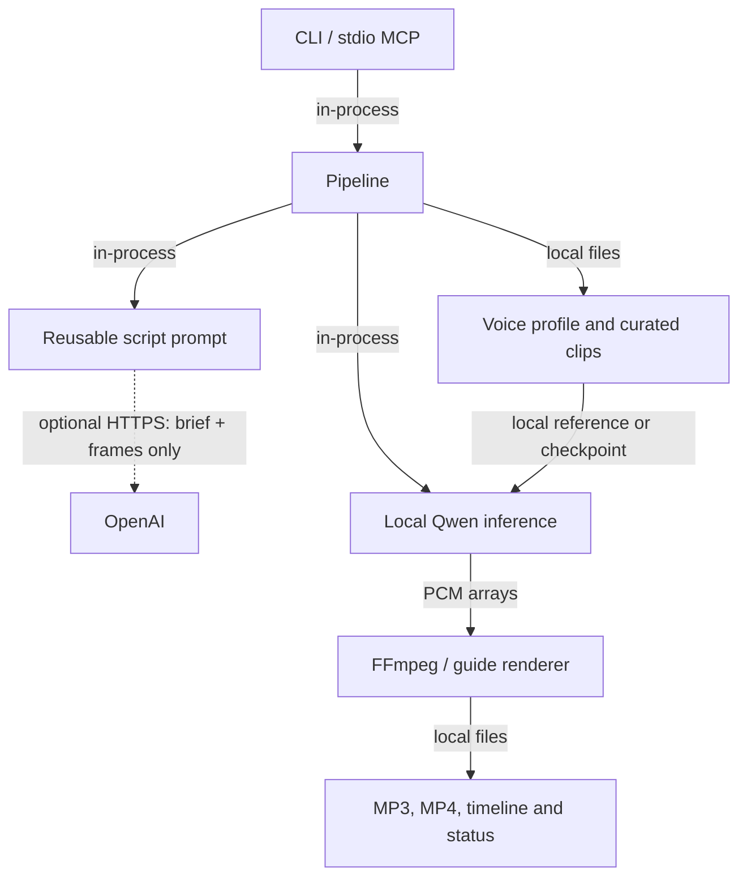
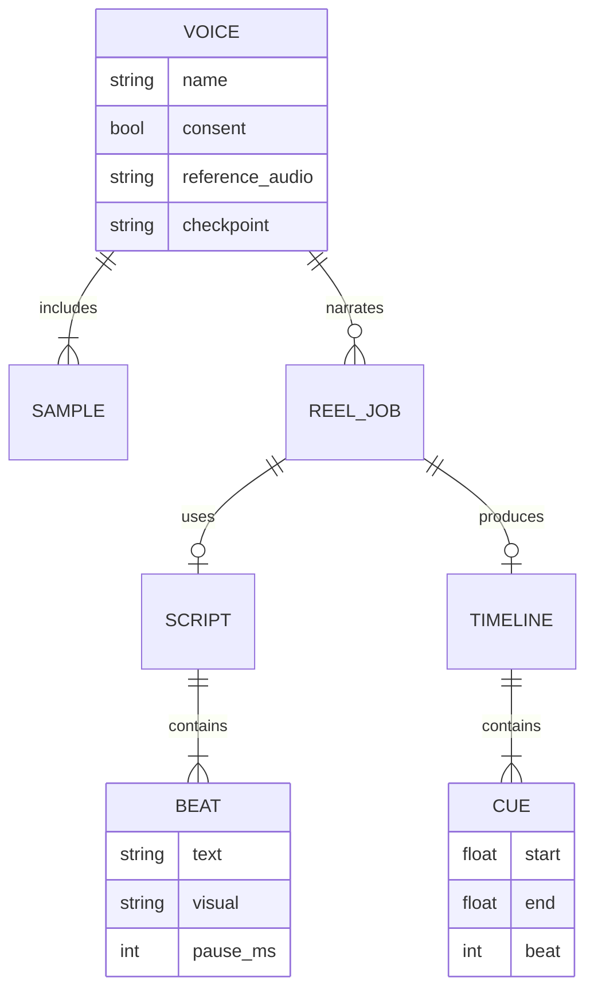

# Local personal-voice reel pipeline

| Field | Value |
|---|---|
| Owner | Arka |
| Status | Implemented baseline; real voice/GPU quality validation pending |
| Last updated | 2026-10-29 |
| Services in scope | CLI, stdio MCP, script prompt, local Qwen speech, media renderer |
| Reviewers | Owner listening review required |

Yapit favors a small local pipeline over a distributed service. A reusable prompt
replaces the originally requested script agent, per the updated requirement.
Model choice below is a justified engineering choice, **not a claim of universal
best quality**. This environment has no supplied voice samples, CUDA tooling or
speech-model installation, so personal-voice similarity and training performance
remain unmeasured.

## 1. Problem Statement

The requested gaps are A: natural scripts from a topic/image/video; B: personal
voice with curated recordings and optional actual training; C: duration-fit MP3;
D: a portrait blank-frame cut guide; E: composable CLI/MCP orchestration.
The user selected local-only voice cloning, English with a natural Indian accent,
and optional cloud script/vision processing. No cloud speech provider is configured.

Correctness, explicit consent, duration checks and validation are not traded for
speed. The owner is the only known stakeholder; no corporate services, teams,
on-call rotations or contact aliases are relevant to this standalone project.

### Research findings and decision

**Qwen3-TTS Base 1.7B is the default.** Its official interface supports reference
audio plus transcript, reusable conditioning and single-speaker fine-tuning.
The published family includes a smaller 0.6B Base alternative. English is
supported; Hindi is not in the published ten-language list, so this version
explicitly scopes its interface to English [R1, R2]. Model downloads and runtime
cost are the tradeoff. An Indian accent is expected to come from recordings,
not an accent selector; whether it is preserved must be measured by the owner.
`YAPIT_MODEL` may select the 0.6B Base model for reference inference only.

**Chatterbox was considered, not integrated.** The current official repository
describes English Turbo, multilingual V3 and CPU-oriented Nano; this makes it
a credible future CPU/latency alternative. Its published examples focus on
reference cloning [R3]. We chose Qwen because its verified single-speaker training
workflow lets reference cloning and actual training share one family. This does
not establish that Qwen sounds better than Chatterbox for this speaker.
No benchmark numbers are transferred from vendor hardware to this machine.

**Conditioning is not training.** Reference enrollment does not update weights.
It chooses one recording and its exact transcript for in-context learning (ICL:
using a paired audio/text example at inference). Actual supervised fine-tuning
(SFT: updating model weights on examples) is a separate `voice-train` operation
using upstream tools [R4]. Multiple enrollment clips are not incorrectly passed
as if upstream batch reference inputs were one pooled multi-recording identity.

**A recent independent study matters.** The October 16, 2026 preprint finds
conditioning-method tradeoffs, sensitivity to incorrect short reference transcripts,
and disagreement between objective measures and listener preference [R5].
That evidence favors accurate transcripts and listening review over assuming
that a published benchmark or a speaker-similarity metric guarantees good reels.
The study is a preprint, not a guarantee about our recordings.

### Recording and evaluation policy

These are **project heuristics**, not vendor promises: use a consistent microphone
and room, normal vocal effort, clean complete phrases, 3-20 second manually cut
clips and several 8-12 second reference candidates. For SFT, aim for 5-15 useful
minutes across hooks, calm explanations, numbers, place/product names and endings.
Do not train solely on monotone reading or on synthetic repetitions.

Store WAV or lossless originals. Avoid music, other speakers, aggressive denoise,
reverb, clipped peaks and stitched syllables. Proofread contractions, numbers and
pronunciation against the audio. The project resamples to mono 24 kHz; it does not
silently trim recordings and invalidate their transcripts.

`voices.py:audio_quality` checks duration, clipping (>0.1%), signal RMS
(<-40 dBFS), and very-quiet-frame proportion (>60%). RMS is signal energy;
dBFS expresses it relative to the maximum digital level. These checks do **not**
measure signal-to-noise ratio, recognize speech or prove the transcript is right.
The reference-ranking score is heuristic. The measured transcript WPM (words per
minute) is bounded to 100-210 only to budget prompts, not to change voice identity.

## 2. Implementation

### Components and communication

Backed by: `src/yapit/{cli,server,pipeline,scripts,voices,speech,media}.py`.
Solid arrows are synchronous local calls/file access; the dotted edge is optional HTTPS.

**Entry** consists of Typer CLI commands and the stdio MCP server. They validate
structured parameters and synchronously invoke Pipeline. MCP confines local file
access to its configured workspace and admits one heavy job per server process.
The maintained MCP SDK v1 API is deliberately bounded below v2 for this implementation
and tested through a real stdio client, rather than relying on v2 compatibility [R8].

**Pipeline** persists the brief/status, chooses a supplied script or optional
generated script, invokes speech per semantic beat and passes audio to media.
Failure is recorded, never reported as a successful reel.

**Reusable script prompt** is packaged as `script_prompt.txt`. It budgets words,
requires factual grounding, avoids generic influencer phrasing, and defines
structured beats with punctuation, pauses and visual suggestions.
An assistant can use it directly, with no API subscription or agent orchestration.

**OpenAI** is an optional HTTPS dependency used only by `--auto-script`.
The adapter sends text and locally extracted JPEGs and requests a Pydantic-shaped
script through Responses structured output [R6, R7]. There is one bounded
duration-estimate revision. It sends neither voice samples nor video source audio;
cloud use additionally requires `YAPIT_ALLOW_CLOUD=true`. No web browsing or
retrieval is implemented: time-sensitive itinerary/product claims need supplied facts.

**Voice profile and clips** are private local files recording consent attestation,
verified transcript inputs, relative audio paths, signal quality, hashes and the
selected reference/checkpoint. Consent is not biometric verification.
Review profiles before using them; do not ingest untrusted model checkpoints.

**Local Qwen inference** lazily loads the model and creates one reusable reference
prompt per job. It uses English ICL reference cloning or the selected fine-tuned
CustomVoice speaker, never a stock speaker disguised as the user.
SDPA (PyTorch's built-in attention implementation) avoids requiring FlashAttention
for inference. CPU uses float32; supported GPU precision is selected at runtime.
Generation remains local after model downloads; offline operation requires caching
the model and tokenizer ahead of time. Short-beat synthesis improves timing
observability but can lose inter-sentence continuity; listening tests must catch it.

**FFmpeg / guide renderer** converts and encodes media via subprocess argument
arrays, not shell interpolation. It measures each synthesized beat, inserts explicit
pause samples and builds a continuous timeline. Beats are the primary semantic cuts;
long beats get approximate sub-cuts near low-energy positions, not forced-aligned
word timestamps. `timeline.json` states the method. Slates show clip number/time;
visual suggestions are in the timeline and editable captions in SRT.
Video is H.264/AAC at 1080x1920, 30 fps. MP3 is 192 kb/s at 48 kHz.
Audio normalization targets -16 LUFS and -1.5 dBTP, with a limiter; these are project
delivery choices, not claimed Instagram requirements or a measured mastering certificate.
FFmpeg documents `atempo` and `loudnorm` filter semantics [R9].

**Output** is a unique directory per job with JSON status and atomic JSON writes.
Original WAV, fitted WAV and provenance remain available for diagnosis.
Failures may leave private partial artifacts; delete only those specific job directories
when no longer needed. No automatic uploads, commits, publication or remote deletion.

### Duration fitting and transition policy

Text estimates use words / WPM * 60 plus configured pauses. Synthesis produces
actual PCM lengths, so post-generation fitting uses measured duration. Apply
`atempo` only for factors between 0.90 and 1.10. Otherwise accept the unmodified
audio only if already within +/-5s; reject larger mismatches with a rewrite request.
Never truncate a spoken sentence to force a target. If the owner supplies a script,
Yapit does not rewrite it behind their back. Optional cloud script generation checks
estimated timing before synthesis; a measured miss still fails rather than incurring
unbounded extra LLM/GPU retries.

Cuts align to measured beat boundaries including pauses. Additional long-beat
cuts are estimates; captions for those cuts use proportional word groups.
No claim of forced alignment or shot detection is made. Six frames at five-second
intervals from the first 30 seconds provide limited video context, not a full-video
understanding system. There is no background-music beat detector.

### Actual training

`training.py:train` uses a clean, explicitly supplied official checkout and records
its Git commit. It keeps ~10% of clips held out, writes upstream-compatible
`audio/text/ref_audio` JSONL, prepares audio codes and invokes upstream SFT.
The reference is the same across examples, following upstream guidance [R4].
The held-out transcript/audio targets are not optimized on; the common conditioning
reference can itself come from the full enrollment set, so this is not a strict
unseen-reference research evaluation.

An important source-level detail: the inspected upstream trainer unconditionally
uses bfloat16/FlashAttention and copies its base-model path as a local directory
when saving [R10]. Yapit therefore requires Linux/CUDA/bfloat16/FlashAttention,
downloads a real local Hub snapshot first, and passes that directory rather than
a Hub identifier. No modifications to upstream training logic are hidden.
Upstream defaults/code may evolve; pin and review the checkout before execution.
The prep script's internal batch size is upstream-controlled and can also cause OOM.

Each checkpoint remains a candidate. The owner compares epochs on held-out phrases
before `voice-use-checkpoint` updates the profile. No automatic "best epoch" claim,
no self-improvement from arbitrary generated scripts, and no claim that reference
conditioning has trained a model. Training logs and snapshot/commit provenance are
retained. Training failure preserves the prior profile.

### Scale, backpressure and failure domains

**Sizing estimates, not measured throughput:** one creator, ten 30s reels/day.
24 kHz mono PCM16 is 24,000 * 2 * 30 = 1.44 MB/reel per WAV. Three retained WAVs
are ~4.32 MB; 192 kb/s MP3 is 192,000 / 8 * 30 = 0.72 MB. Video and model/checkpoint
size are workload-dependent, not included. That is ~50.4 MB/day (~1.51 GB/month)
for WAV/MP3 alone. Ten minutes of source PCM is ~28.8 MB.

Average write jobs = 10 / 86,400 = 0.000116 jobs/s. Design peak is one heavy job
at a time per MCP process, not a throughput guarantee. A 30s reel with eight beats
amplifies into eight sequential TTS calls and optionally <=2 LLM calls.
Status-read peak is an assumed one read/s during external inspection.
If a render takes T seconds, sequential capacity is 1/T jobs/s; measure T on the
target GPU rather than inventing a real-time factor.

Backpressure: the MCP lock rejects overlapping heavy requests with "busy"; it is
not a durable queue and does not coordinate multiple processes. The CLI should run
one job per GPU. GPU memory, upstream code preparation, model downloads, optional
API rate limits and disk encoding are the pressure points. Use short scripts,
bounded input sizes, bounded retries/timeouts and manual retry after failures.
There is no shared production service, queue, tenant model or autoscaling.

| Single point of failure | Blast radius | Mitigation |
|---|---|---|
| Local machine / GPU | Current generation/training stops | Keep source recordings; retry on configured machine |
| Local filesystem | Private voices and jobs may be lost | Owner-managed encrypted backup; do not commit recordings |
| Model download host | Cold starts fail | Cache weights/tokenizer first |
| Optional OpenAI | Automated scripts fail | Use reusable prompt + manually supplied script |
| FFmpeg process | Media output fails | Error status and retained WAV/timeline for diagnosis |

### Storage and data model

No database or broker is introduced: files fit a single-creator workload and keep
biometric recordings local. Distributed CAP tradeoffs do not formally apply to a
single local filesystem; the table uses the template's single-node CA shorthand,
not a guarantee that a failed disk stays available. CAP means consistency,
availability and partition tolerance; under a distributed partition one must trade
consistent answers against non-error availability.

<table>
<tr><th>StorageTypeName</th><th>UseCases</th></tr>
<tr style="background-color:#90EE90;color:#000000"><td>Local filesystem (single-node CA shorthand)</td><td>Private profiles, WAVs, JSON job status and checkpoints. Chosen for locality and simple file-based editing; no distributed partition tolerance, replication or multi-process transaction guarantees.</td></tr>
</table>

Legend: Light-Green = CA; Light-Yellow = AP; Light-Red = CP. Black text on shaded rows.

Backed by: `models.py`, `pipeline.py` persisted script/timeline/provenance, `voices.py`.
These are file-backed entities, not fictitious SQL tables. Prompt-only jobs precede
voice selection; REEL_JOB here denotes narration/render attempts.

Verified good practices to preserve: local-only speech, no silent rewrites/truncation,
explicit cloud opt-in, structured contracts and tested media output.
Remaining gaps: listening validation, GPU SFT execution and real provider validation.
No dashboard service is needed. Job seconds and tempo factor are already persisted;
future measurements should chart latency as a distribution and duration error as
an absolute-error histogram, not a misleading single success average.

## 3. Success Criteria

| Feature | Baseline | Target / guardrail |
|---|---|---|
| Prompt | New implementation | Reusable without API; JSON script schema and factual constraints |
| Personal voice | Unmeasured | Owner approves accent, identity and naturalness on held-out samples |
| Transcript adherence | Unmeasured on real TTS | Manually verify proper nouns, no omissions/repetitions |
| Duration | Tested with synthetic PCM | Actual encoded output within +/-5s; no >10% stretching |
| Timeline | Measured beats | Continuous from 0 to final duration; stated sub-cut uncertainty |
| Guide | Tested with real FFmpeg | H.264/AAC, 1080x1920, 30fps, audible narration |
| Training | Source-verified, not GPU-executed here | Candidate checkpoint + logged provenance; no auto-promotion |
| Privacy | Local voice path | No voice sent to OpenAI; MCP cannot read files outside root |

Overall exit for **personal-voice production readiness** additionally requires a
real enrollment, on-device synthesis and an owner listening pass. Automated fake
speech tests cannot satisfy those criteria.

Suggested owner test set: travel place names, dates, currency, contractions,
one calm itinerary, one excited hook and one balanced product verdict. Compare
the reference baseline with each fine-tuned epoch on identical scripts. Record
identity, accent and naturalness scores (1-5), pronunciation errors and repetition;
choose a checkpoint only if it improves the intended use case without regressions.
These scores are a proposed rubric, not fabricated measurements.

## 4. Task Breakdown

Delivered baseline is mapped to three follow-on validation items, each estimated
at 1-2 weeks of part-time capture/measurement work, not an invented delivery promise.

1. **VOICE-1 (Gap B):** capture/proofread 5-15 minutes plus holdout test scripts;
   verify reference selection and record owner listening scores. No dependency.
2. **VOICE-2 (Gap B/C):** run pinned upstream SFT on target GPU, compare epochs to
   the VOICE-1 baseline, record VRAM/latency and select or reject a checkpoint.
   Depends on VOICE-1.
3. **REEL-1 (Gap A/D/E):** exercise real topic/image/video scripts and five real
   reels, verify duration/transition usefulness; tune prompts and evaluate whether
   forced alignment or a smaller CPU backend is justified by evidence.
   Depends on VOICE-1; does not require successful SFT.

## 5. Reference Links

Sources checked 2026-10-29. Primary vendor docs/code describe capabilities;
the independent preprint supplies a separate evaluation, not product certification.

- **R1:** Qwen upstream model family and usage:
  https://github.com/QwenLM/Qwen3-TTS
- **R2:** Official Base model card and Apache-2.0 weights license:
  https://huggingface.co/Qwen/Qwen3-TTS-12Hz-1.7B-Base
- **R3:** Chatterbox alternatives and usage:
  https://github.com/resemble-ai/chatterbox
- **R4:** Official single-speaker fine-tuning format and workflow:
  https://github.com/QwenLM/Qwen3-TTS/blob/main/finetuning/README.md
- **R5:** Baroudi et al., *Beyond the Benchmark: Conditioning, Domains and Failure
  Modes of Qwen3-TTS*, submitted 2026-10-16:
  https://arxiv.org/abs/2610.23678
- **R6:** OpenAI structured output:
  https://developers.openai.com/api/docs/guides/structured-outputs
- **R7:** OpenAI image inputs:
  https://developers.openai.com/api/docs/guides/images-vision
- **R8:** MCP SDK v1 maintenance documentation:
  https://py.sdk.modelcontextprotocol.io/v1/
- **R9:** FFmpeg filter implementation documentation:
  https://github.com/FFmpeg/FFmpeg/blob/master/doc/filters.texi
- **R10:** Actual upstream trainer, especially model loading and checkpoint saving:
  https://github.com/QwenLM/Qwen3-TTS/blob/main/finetuning/sft_12hz.py

Local implementation source of truth: `src/yapit/models.py` (contracts),
`voices.py` (curation), `speech.py` (reference/trained inference),
`training.py` (upstream orchestration), `scripts.py`/`script_prompt.txt` (prompt),
`pipeline.py` (artifacts/status), `timeline.py` (cuts), `media.py` (real encoding),
`server.py` (confined stdio tools), `tests/` (automated evidence).
No internal wiki, contact directory, telemetry, PR or dashboard evidence exists for
this new independent project. To add: owner listening results, target GPU sizing,
the exact reviewed SFT checkout commit and real API validation, tied to VOICE-1/2
and REEL-1 rather than pretending those have already been measured.
