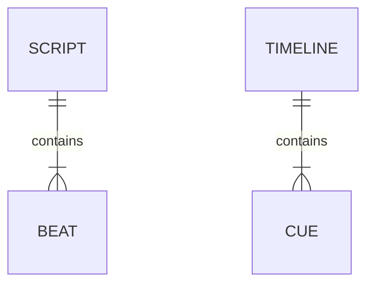

# Audio Quality and Code Review — Yapit

| Field | Value |
|---|---|
| Owner | Repository owner |
| Status | Code-validated investigation; recommendations, not implementation |
| Last updated | 2026-11-08 |
| Services in scope | Yapper, timing/media utilities, Training, Enrollment, Rescript, Musicgen, storage, CLI/Pipeline/MCP |
| Reviewers | Repository owner; external reviewers not assigned |

**Bottom line:** switching from JSON to plaintext currently does **not** bypass
sentence splitting, added pauses or duration fitting. Audio-only generation can
retime the whole recording; video generation uses a no-stretch path. The selected
0.6B checkpoint does not support descriptive delivery instructions in the
installed SDK. These are verified code behaviors, not proof that training has
overfit or that a different setting will sound better.

## 1. Problem Statement

The reported symptom is uneven pace and disappointing narration. This review
separates four possible sources: synthesis/prosody, chunk boundaries, application
tempo fitting and approximate captions. **Prosody** means the rhythm, emphasis
and pitch within spoken language. No new speech, training, transcription or
listening comparison was performed.

Conditioning speech on supplied words is normal TTS behavior, not runtime
training: the inference path does not update weights. **Training overfit** means
learning the training examples too specifically to generalize; that requires
held-out evidence. Losing conversational context through separate sentence calls
is a different, application-level issue. Sources:
`src\yapper\speech.py:83-104`; `src\training\trainer.py:91-95,146-165`.

### Verified gaps

| Gap | Finding | Evidence |
|---|---|---|
| A — Plaintext is not continuous narration | `Script.from_text` splits on sentence punctuation or blank lines. Every resulting beat defaults to 180 ms silence, including the final beat. Each beat gets an independent TTS call. | `src\models.py:25-28,58-61`; `src\yapper\generation.py:61-77` |
| B — Audio/video timing policies differ | Audio-only routes call `fit_audio` without natural-duration tolerance and can apply `atempo`. Video supplies a 33% tolerance and returns the unmodified waveform with factor 1. | `src\yapper\generation.py:145-147`; `src\common_utils\mediautils.py:149-178`; `src\pipeline.py:105-115` |
| C — Effective speech settings are implicit | The wrapper only passes text, English and `max_new_tokens=2048`; other sampling values come from checkpoint/SDK defaults. There is no inference-settings object or complete effective-settings provenance. | `src\yapper\speech.py:83-95`; `src\yapper\generation.py:40-55` |
| D — Instructions cannot control this checkpoint | The selected checkpoint is `custom_voice`, size `0b6`; the installed SDK discards `instruct` for that size. Recorded styles are separately restricted to Base cloning. | `data\arka\checkpoints\arka.training\checkpoint-epoch-2\config.json`; `.venv-gpu\Lib\site-packages\qwen_tts\inference\qwen3_tts_model.py:799-800`; `src\enrollment\styles.py:76-77,126-127` |
| E — Captions are approximate | The timeline distributes words by count and searches quiet windows around proposed cuts. It scales cue durations, not waveform samples; this is not word alignment and can look out of sync. | `src\yapper\timeline.py:19-63` |
| F — Overfit is unmeasured | The trainer reserves a holdout, but does not run or record a held-out quality evaluation. Current enrollment signal checks do not measure speech naturalness or transcript accuracy. | `src\training\trainer.py:91-95,167-201`; `src\enrollment\profiles.py:19-43` |

These policies have recognizable purposes: the short-beat prompt supports edit
guides, explicit pauses support JSON scripts, and legacy audio-only fitting tries
to accommodate a requested duration. They are not necessarily the best defaults
for natural continuous narration. The prompt specifically suggests 5–16-word,
2–5-second beats; it is not passed to TTS when supplied text is used.
Sources: `src\yapper\script_prompt.txt:19-24`;
`src\yapper\speech.py:83-95`; `src\pipeline.py:97-104`.

### What the existing Thailand result establishes

Its status records **42.02 seconds of narration, tempo factor 1.0 and 42.8 seconds
of video**, with the selected epoch-2 checkpoint and no cloud script generation.
Thus this particular result was **not accelerated by application tempo fitting**.
It does not establish why any phrase sounded faster: chunk-level/model prosody
or perceived pacing remain possibilities, not conclusions.
Sources: `workspace\outputs\arka.thailand_7days.2.status.json`;
`workspace\outputs\arka.thailand_7days.2.provenance.json`.

The current quality inventory contains **16 clips / 225.91 seconds = 3.77 minutes**.
This is the current enrollment inventory, not independently verified provenance
of the selected training run. With 16 records, the current split code would
produce 15 training targets and one held-out target. Small coverage makes
generalization worth checking, but is not evidence of overfit. The trainer's
5–15-clean-minute recommendation is a project recommendation, not a guaranteed
quality threshold. Sources: `data\arka\arka.quality.json`;
`src\training\trainer.py:91-95,103-106`.

### Scope and standards

Use idiomatic, cohesive Python functions, keep inference separate from timing
and publication, and expose meaningful behavior rather than every constant.
Preserve safety/correctness checks. Keep ordinary validation unit-only; expensive
checks require explicit authorization and belong in integration folders.
Source: `.github\instructions\python-and-testing.instructions.md`.

No external owning teams, on-call rotations or contacts are established for this
local repository; none are invented here.

## 2. Implementation

**Everything below is proposed. No production settings, weights or source code
were changed during this investigation.**

### Recommended narration behavior

1. **Make natural timing the default for narration, with fitting explicitly
   opt-in.** Propose `timing_mode="natural" | "fit"` and an optional target
   duration. Natural mode should synthesize first and measure afterward; a
   requested duration can be a budget/warning without automatic stretching.
   Retain the legacy fitting behavior as an explicit compatibility choice.
   This addresses B without pretending that removing fitting fixes model prosody.
   Sources: `src\common_utils\mediautils.py:133-178`;
   `src\yapper\generation.py:118-147`.

2. **Decouple speech chunks from visual beats.** Propose
   `speech_chunking="paragraph" | "beat"`. Preserve paragraph context where
   practical, then produce visual cuts/captions from the finished waveform.
   Do not treat the JSON-versus-text file format itself as a quality setting.
   Keep bounded chunks and sentence-aware splitting for long passages rather
   than attempting an unlimited monologue. Paragraph mode may improve continuity,
   but must be compared later; longer context also costs memory and can worsen
   repetition or truncation. Sources: `src\models.py:58-61`;
   `src\yapper\generation.py:61-77`; `src\yapper\speech.py:99-104`.

3. **Use explicit pauses selectively, with no automatic final pause for
   plaintext.** A future plaintext policy should not inject 180 ms after every
   sentence simply because parsing created a beat. Preserve user-authored JSON
   pauses rather than silently rewriting them. A model-generated sentence may
   already contain a pause; whether the added gap sounds excessive is unmeasured.
   Sources: `src\models.py:25-28`; `src\yapper\generation.py:75-77`.

These are the first changes to evaluate because they address verified application
behavior while preserving the selected voice. Do not retrain, switch model size
or change ten sampling parameters at once.

### Can descriptive plaintext or no script be better?

| Input/model choice | What is supported here | Recommendation |
|---|---|---|
| Exact spoken plaintext | Supported, but converted into sentence beats and fitted on the audio-only route. | Useful input format; not currently a bypass for timing/chunking. |
| A coherent spoken paragraph in one JSON beat | The wrapper passes the complete beat text to one synthesis call. | A future controlled comparison can isolate context length without changing file-format semantics. Still subject to the wrapper's 45-second chunk limit. |
| Delivery directions placed inside narration, e.g. “speak warmly...” | They enter the ordinary `text` argument; there is no instruction/text separation in `QwenSpeech`. | Do not put non-spoken directions in narration: they may be spoken rather than act as controls. |
| Separate descriptive `instruct` on selected 0.6B CustomVoice | Ignored by the installed SDK; the official model matrix does not list instruction control for 0.6B CustomVoice. | Do not advertise this as a working configuration for Arka's current checkpoint. |
| 1.7B CustomVoice / VoiceDesign instruction control | Officially supported model families, but not the selected fine-tuned 0.6B checkpoint. | Not a drop-in quality fix; model/voice identity, memory and latency must be evaluated separately. |
| Base cloning with an expressive recording | Existing `enroll_style`/`select_voice` supports reference-driven styles, not checkpoint mode. | A second, explicit comparison route if needed; never silently deselect the trained checkpoint. |
| TTS with no spoken text | The current API requires text and does not compose a freeform travel narration from a description. | Content drafting and speaking remain separate operations. Do not confuse VoiceDesign with automatic scriptwriting. |

Backed by: `src\yapper\cli.py:25-47`;
`src\yapper\speech.py:83-95`; `src\enrollment\styles.py:53-142`;
installed SDK `qwen3_tts_model.py:732-834`; official Qwen model matrix and API
source listed in section 5. **A better-sounding result is unverified until a
later authorized listening comparison.**

### Configuration inventory and what to change first

“Proposed” values are experiment candidates, not new defaults or proven fixes.

| Setting | Current effective behavior | Assessment / proposed action |
|---|---|---|
| Selected model/speaker | Epoch-2 0.6B CustomVoice; `arka` | Preserve initially. Separate checkpoint selection from synthesis tuning. |
| Text context | One independent request per `Beat.text` | Highest-priority comparison: sentence/beat versus coherent paragraph context. |
| Language | `English` is hardcoded; `Brief.language` is not forwarded | Expose through speech settings eventually; keep English for the first comparison to avoid confounding pronunciation changes. |
| Target duration | Audio-only default 30s; video subtracts closing hold before narration | Propose optional duration + explicit natural/fit policy. |
| Tempo fitting | Whole-waveform `duration / target` factor, allowed 0.90–1.10; otherwise ±5s handling or rejection | It is one global factor, not per-phrase acceleration. Make fitting opt-in. |
| Inter-beat/final pauses | `Beat.pause_ms=180` by default | Separate plaintext pause defaults from explicit JSON pauses; default plaintext final pause to zero in a future change. |
| Main sampling | `do_sample=true`, temperature `0.9`, top-k `50`, top-p `1.0`, repetition penalty `1.05` | Record these explicitly. If pacing remains poor, a modest temperature comparison such as 0.9 versus 0.7 is a **hypothesis**, not a speed control or assured improvement. |
| Subtalker sampling | Enabled, temperature `0.9`, top-k `50`, top-p `1.0` | This controls additional codec-code generation. Hold constant initially; do not assume changing it alone controls speaking rate. |
| Token ceiling | Wrapper `2048` overrides checkpoint `8192` | A maximum, not a speaking-speed target. Investigate truncation only if symptoms indicate missing endings. Raising it can extend worst-case latency. |
| Full-text conditioning | CustomVoice SDK defaults `non_streaming_mode=True`; Base clone defaults `False` | Current checkpoint already uses full-text conditioning **within each beat**, not across the whole script. Make the setting explicit; do not claim it was disabled. |
| Reference transcript mode | Base cloning sets `x_vector_only_mode=False` | Not used by the selected checkpoint. Relevant only to a separate Base-reference comparison. |
| Device/dtype/attention | `YAPIT_DEVICE`; CUDA path prefers BF16; attention fixed to `sdpa` | Execution configuration, not a direct pace control. Do not attribute uneven speech to CPU merely because external FlashAttention is absent. |
| Cache / resident worker | Exact-text waveform cache; one resident model; `YAPIT_SPEECH_CACHE=0` bypasses reuse | Keep residency. Future A/B comparisons need cache keys containing effective inference settings and an explicit seed policy. |
| Word-rate metadata | Current profile about 131.47 WPM; enrollment clamps estimated rate to 100–210 | Planning metadata, **not** a TTS rate parameter. Changing this does not directly change model pace. |
| Join ramps | 5 ms amplitude ramps at chunk boundaries | Avoid click artifacts; they do not stretch time. Preserve initially. |
| MP3 processing | -16 LUFS normalization, limiter, 48 kHz, 192 kbps | Changes loudness/encoding, not an explicit tempo operation. Keep separate from prosody tuning. |
| Visual cuts | Nominal max 4s, quiet-window search ±0.30s, word-count caption partition | Post-synthesis planning only. Expose a small cut-planning policy if needed; actual word alignment is a separate feature. |
| Training defaults | 3 epochs, batch 1, learning rate `2e-6`; public CLI omits learning-rate control | These are code defaults, **not confirmed settings for the selected run**. Do not adjust training until held-out quality and provenance are established. |

Sources: selected checkpoint `config.json` and `generation_config.json`;
`data\arka\arka.profile.json`; `src\yapper\speech.py:34-104`;
`src\yapper\generation.py:57-99`; `src\common_utils\mediautils.py:133-198`;
`src\yapper\timeline.py:19-63`; `src\enrollment\profiles.py:163-176`;
`src\training\trainer.py:19-29`; `src\cli.py:294-316`;
installed SDK `qwen3_tts_model.py:288-352,470-478,732-834`.

**Cache caveat:** `SpeechEngine` currently identifies the model using
checkpoint/reference metadata, SDK version and applicable base-model environment,
then hashes that identity with exact text. This fits the current limited API.
If per-request language, sampling, seed, instruction or conditioning mode is
introduced, those must enter the **waveform cache key**, without making each
setting change unload identical weights. Record effective settings and cache-hit
status in generation provenance. Sources: `src\yapper\worker.py:136-169,194-206`;
`src\yapper\generation.py:40-55`.

### Remaining code: meaningful function boundaries

Line counts include signatures/docstrings and are not quality scores. The review
covered production implementations and adapters; test review was targeted/static,
not an exhaustive audit of every assertion.

| Area | Current assessment | Focused recommendation |
|---|---|---|
| Yapper generation | `render_audio` is 90 lines combining provenance, synthesis/joining, fitting/encoding and timeline publication. | Extract `synthesize_chunks` and `publish_narration`; keep a readable coordinator. Timing policy and speech configuration should be independent inputs. |
| Yapper speech | `_load` is 48 lines; synthesis is already small/cohesive. | Introduce one speech-settings contract; separate model-load settings from request settings. Do not create wrappers solely for line count. |
| Worker | `SpeechEngine.synthesize` is 62 lines owning load/cache lookup, inference, cache write/eviction and metrics. | Extract cache read/write-and-prune; retain the one-model residency and serialization policy. |
| Timeline | `build_timeline` is 58 lines combining cut selection and caption word partitioning. | Extract quiet-cut selection; make clear that captions remain approximate. Do not use caption timestamps to drive speech tempo. |
| Pipeline | `reel` is 119 lines, mixing script acquisition, narration, music planning, rendering and status publication. | Extract script acquisition and guide publication stages; keep orchestration explicit. Avoid duplicating timing defaults across adapters. |
| Training | `train` is 191 lines covering environment/upstream checks, splits, model preparation, command construction, execution and results. | Separate dataset preparation and command construction/execution. Keep reviewed-upstream and architecture checks; make model-weight continuation distinct from optimizer resume. |
| Checkpoint continuation | `prepare_resume_model` is 53 lines; tensor validation is justified correctness work, not incidental overengineering. | Preserve compatibility checks. Avoid repeatedly opening the same base shard for individual missing encoder tensors if measurements show meaningful overhead. |
| Enrollment | `save_take` is 81 lines; `enroll` is 88 lines. Signal preparation, duplicate checks and publication are interleaved. | Extract pure trimming/normalization and curation; centralize quality thresholds without weakening them. Reuse sample digests where appropriate rather than repeatedly hashing every accepted file on each save. |
| Enrollment UI/recorder | UI constructor is 123 lines of widget/state setup; recorder `prepare` is 64 lines. UI already sends blocking work to a thread. | Separate UI state initialization from widget construction; keep stream lifecycle together. Name shared capture-duration/buffer defaults rather than repeating `20` across recorder/session/UI. |
| Rescript | `transcribe` is 79 lines; `compose_scripts` is 66 lines. The latter uses global partition planning to avoid invalid tails. | Separate decoding/recognition from script publication. Retain global partition planning; make its 30–60s part policy explicit if requirements change. `extract_audio` fully decodes even files it ultimately copies: consider a lighter supported-audio validation path, preserving corrupt/no-audio errors. |
| Musicgen | Planner is 73 lines; download is 71 lines; scoring/source verification are separate. | Use a named profile record instead of positional tuples. Extract normalization/publication from acquisition. `_read(output=...)` still buffers the whole payload and returns a second bytes object; stream bounded downloads to file when output is requested. Keep source-license and URL checks. |
| Storage/utilities | Mostly short cohesive helpers. `reserve_artifact_name` materializes every glob match just to test existence. | Use an iterator existence check. Do not add repository/cache classes around simple file helpers. JSON atomic replacement and exclusive creation remain useful. |
| CLI/MCP | CLI duplicates `AudioMix` construction; `create_server` spans 172 lines mainly because it contains registered tools. | Share small options-to-settings adaptation if repetition grows. Preserve discoverable tool names and docstrings; registration scope alone is not a reason for a giant service class. MCP hardcodes 1080x1920/30 despite the broader Timeline API; document or deliberately expose that adapter restriction. |

Backed by measured AST spans and reads:
`src\yapper\generation.py:26-115`; `src\yapper\speech.py:34-104`;
`src\yapper\worker.py:194-255`; `src\yapper\timeline.py:11-68`;
`src\pipeline.py:57-175`; `src\training\trainer.py:19-209`;
`src\training\checkpoints.py:51-103`; `src\enrollment\session.py:147-227`;
`src\enrollment\profiles.py:108-195`; `src\enrollment\desktop.py:26-148`;
`src\enrollment\recorder.py:54-117`; `src\rescript\transcription.py:113-259`;
`src\rescript\audio.py:19-58`; `src\musicgen\planner.py:31-103`;
`src\musicgen\catalog.py:53-73,239-309`;
`src\common_utils\fileutils.py:57-77`; `src\cli.py:177-270`;
`src\mcp\server.py:22-193`.

### Keep, consolidate and relocate tests

Editor/Enrollment unit-only defaults and `tests\integration` placement are already
implemented. The full-render test remains deleted. Other modules still include
expensive workflows in ordinary test folders: Yapper generation tests use a fake
voice backend but real media/Enrollment fixtures; Worker tests start a real HTTP
server and enrolled fixture; Rescript/MCP/Training tests include external processes.
Those are **integration tests despite using fake model outputs**, and should be
relocated/opt-in in a separate authorized cleanup, not run in routine validation.
Sources: `conftest.py`; `src\yapper\tests\conftest.py:38-52`;
`src\yapper\tests\test_generation.py:16-149`;
`src\yapper\tests\test_worker.py:42-62`;
`src\rescript\tests\test_rescript.py`;
`src\mcp\tests\test_server.py`; `src\training\tests\test_training.py`.

The Yapper plaintext test currently asserts exact sentence splitting and
`[180,180]` pauses. That is functional evidence of the old policy, but must change
if a new plaintext policy is deliberately adopted; it should not veto that
product decision. Keep tests for unchanged spoken words, input preservation,
valid boundaries and correct no-stretch behavior. Do not replace coverage with
tests of source strings/private filenames.
Source: `src\yapper\tests\test_generation.py:16-39`.

### Responsibilities and resource limits

**Speech:** `QwenSpeech` receives text through a synchronous Python interface;
the optional client calls the local worker over authenticated HTTP. The worker
serializes requests and retains one model. Sources:
`src\yapper\speech.py:22-95`; `src\yapper\worker.py:48-126,194-202`.

**Generation/media:** `render_audio` synchronously joins chunks and calls media
helpers for fitting/encoding; FFmpeg runs as a subprocess. Sources:
`src\yapper\generation.py:61-99`; `src\common_utils\mediautils.py:33-48`.

**Timing/adapters:** `build_timeline` produces cue metadata after audio is
generated. Pipeline and CLI/MCP adapt requests and publish job status;
Editor consumes the existing narration and timeline. Sources:
`src\yapper\generation.py:100-115`; `src\pipeline.py:105-170`.

Resource arithmetic from existing contracts:

- A 45s, mono 24 kHz float32 chunk is `45 * 24,000 * 4 = 4,320,000` bytes.
  A 240s timeline corresponds to about 23.04 MB of one waveform array, excluding
  copies/model memory. These are format/config calculations, not measured RSS.
- The speech cache is capped at 250 MiB; a maximum-length FLOAT WAV consumes
  about 4.32 MB plus its header, so roughly 60 such chunks fit. Cache-hit ratio
  and growth rate for real use are unmeasured.
- A script has 1–40 beats: one uncached narration job makes that many sequential
  synthesis calls, not one continuous request.
- Worker concurrency is one synthesis/load operation, with busy requests rejected
  rather than queued. For a chunk taking `t` seconds, uncached service capacity
  is at most `1/t` requests per second; fresh `t` is not measured here.
- Local worker/GPU and local storage are single points of failure. Preserve
  explicit busy/unavailable errors, bounded cache and recoverable job metadata;
  no multi-user service/replication design is proposed.

Sources: `src\yapper\speech.py:103-104`; `src\yapper\worker.py:29-31,194-202,235-247`;
`src\models.py:33,107`; `src\yapper\generation.py:61-77`.

### Data contracts

This is an entity-relationship view of existing in-memory/JSON contracts, not a
proposal for relational tables. The two relationships below are schema-enforced;
audio sample arrays and cache files are omitted.

**Backed by:** `src\models.py:25-33,97-115`.
There is no database or distributed message queue choice in this proposal.
CAP classification would not meaningfully describe these local JSON files,
waveforms or the UI's in-process queue; no speculative storage comparison is added.

## 3. Success Criteria

| Criterion | Baseline / evidence | Proposed exit condition |
|---|---|---|
| Natural timing | Unit-mocked natural path returns factor 1 and never calls tempo fitting | Natural narration is the default; fit remains explicit and logged |
| Plaintext continuity | Two sentences currently become two requests plus 360 ms explicit silence | Documented chunking/pause policy; exact spoken text retained |
| Configuration visibility | Most effective inference settings absent from provenance | Log checkpoint, language, sampling, conditioning mode, seed policy and cache reuse |
| Cache correctness | Current key covers model identity + text | Future request settings distinguish waveforms without reloading identical weights |
| Caption honesty | Approximate word-count partitioning | Do not advertise word alignment; preserve bounded, continuous cues |
| Perceived rhythm/identity | User reports poor audio; no new listening baseline | Later authorized same-text comparison finds acceptable pace and retained identity; no claimed improvement beforehand |
| Overfit/generalization | No held-out quality result located in inspected metadata/code | Evaluate unseen wording separately from training text before deciding to retrain or change epochs |
| Routine validation cost | No integration/model execution in this investigation | Focused units only; expensive tests remain explicit opt-in |

**Validation performed:** all production Python files were AST-parsed for function
spans; five in-memory/mocked unit checks passed in **0.065s of test execution**.
They verify plaintext splitting/pauses, no-stretch natural mode, one global audio
tempo factor, TTS argument isolation and SDK-default precedence. The SDK merge
method was extracted from its AST without importing the SDK or loading weights.
Interpreter/import startup was separate from the reported test duration.

No acoustic improvement, fresh synthesis throughput, GPU/codec profile or
training overfit claim is validated by these checks. No inference/training,
transcription, integration suite or new audio/video generation was run.

## 4. Task Breakdown

The following are proposed work packages, not work started by this review.
Effort ranges are rough planning envelopes; small fixes should not be padded to
fill them. No model experiment is authorized by this document.

| ID | Deliverable | Dependencies | Planning envelope |
|---|---|---|---|
| AQ-1 | Separate natural/fit timing and speech-chunk/pause policies; preserve explicit JSON behavior; add focused mocked units and migration notes (A/B) | None | Up to 1 week |
| AQ-2 | Add effective speech settings, capability checks and provenance; separate cache request identity from resident model identity (C/D) | AQ-1 interface agreement | Up to 1 week |
| AQ-3 | Prepare an opt-in same-text listening protocol: beat/paragraph, natural/fit, then one sampling change; assess unseen text and any alternate Base reference (E/F) | AQ-1/AQ-2; explicit authorization before execution | 1–2 weeks including evaluation |
| CR-1 | Refactor generation/Pipeline and Enrollment at the identified pure/IO boundaries; relocate remaining expensive tests; avoid unrelated rewrites | AQ-1 policy agreement for timing-dependent tests | 1–2 weeks |
| CR-2 | Separate Training/Rescript/Musicgen preparation and publication; improve bounded download buffering and configuration clarity | None; coordinate overlapping adapters with CR-1 | 1–2 weeks |

Prioritize AQ-1/AQ-2 before broad refactoring. Do not change checkpoint selection,
train more epochs or enable a larger runtime merely because the symptom might
be model-related.

## 5. Reference Links

### Local source of truth

- `src\models.py`, `src\yapper\speech.py`, `src\yapper\generation.py`,
  `src\yapper\timeline.py`, `src\yapper\worker.py`: narration contracts/runtime.
- `src\common_utils\mediautils.py`, `src\pipeline.py`, `src\yapper\cli.py`:
  fitting, encoding and entry-point differences.
- Selected checkpoint `data\arka\checkpoints\arka.training\checkpoint-epoch-2\config.json`
  and `generation_config.json`: architecture and generation defaults.
- `data\arka\arka.profile.json`, `data\arka\arka.quality.json`: selected voice
  metadata/current signal inventory; private recordings/weights not reproduced.
- `workspace\outputs\arka.thailand_7days.2.status.json` and `.provenance.json`:
  existing output metadata, not a new listening or performance result.
- `.venv-gpu\Lib\site-packages\qwen_tts\inference\qwen3_tts_model.py:288-352,732-834`:
  installed SDK settings precedence and 0.6B instruction handling.
- `.venv-gpu\Lib\site-packages\qwen_tts\core\models\modeling_qwen3_tts.py:1922-1936,2195-2230`:
  loading `generation_config.json` and full-text conditioning.
- Other review references are cited beside each module finding.

### Official research

Fetched on 2026-11-08; installed code above determines current runtime behavior.
Upstream `main` can change and is not a substitute for the installed version.

- Qwen official model feature matrix and examples:
  `https://github.com/QwenLM/Qwen3-TTS/blob/main/README.md`
- Qwen official inference implementation:
  `https://github.com/QwenLM/Qwen3-TTS/blob/main/qwen_tts/inference/qwen3_tts_model.py`

### Not established

Selected-run learning rate/complete training provenance, held-out listening
scores, within-sentence pace measurements and controlled quality comparisons.
No external dashboards, additional owning teams or approved inference experiment
were established; these remain future AQ-3 inputs, not invented evidence.
