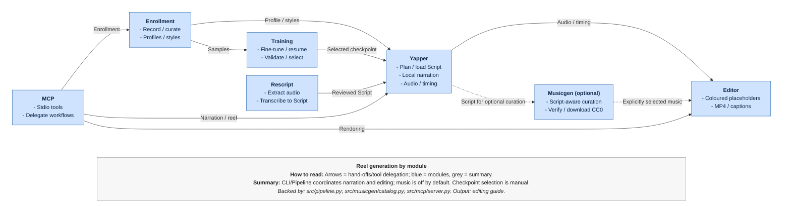

# YapIt developer guide

[Back to YapIt](../README.md). Customer installation and everyday commands live
in the root README; this guide owns shared architecture, configuration and tests.

## Flat source layout

Hatch maps the flat `src` directory to the public `yapit` package.
Module user/developer guides own their workflows and implementation details.

| Source/module | Ownership | Developer guide |
|---|---|---|
| `src` | Contracts, storage, configuration, CLI and Pipeline orchestration | This guide |
| `src\common_utils` | File/media primitives, native model loading, runtime settings and metrics | This guide |
| `src\enrollment` | Recording, curation and reusable voice profiles | [Enrollment](enrollment/dev.readme.md) |
| `src\rescript` | Extraction, recognition and script partitioning | [Rescript](rescript/dev.readme.md) |
| `src\yapper` | Script planning, adapters, narration, worker and timeline | [Yapper](yapper/dev.readme.md) |
| `src\editor` | Mixing, templates and video publication | [Editor](editor/dev.readme.md) |
| `src\musicgen` | Explicit music discovery and source-verified acquisition | [Musicgen](musicgen/dev.readme.md) |
| `src\training` | Qwen fine-tuning and checkpoint validation | [Training](training/dev.readme.md) |
| `src\mcp` | Stdio protocol adapters and client example | [MCP](mcp/dev.readme.md) |

`api.py` exposes `generate_audio`, `generate_script`, `extract_script`,
`generate_reel` and `enroll_voice` as canonical customer Python functions.
CLI names use hyphens; MCP uses the same underscore names. Each workflow has
one public command, without compatibility aliases or helper MCP tools.

`scripts` owns setup/dispatch/build helpers; root `yapit.cmd` is only a public
shim. Module tests live under their source module; root `tests` covers shared
storage, launchers and application interfaces. `agenttests` holds opt-in
packaging/documentation/import-maintenance checks.

## Reel lifecycle

Arrows are local calls or artifact hand-offs, not independently deployed services.



Shared `models.py` contracts validate inputs; `storage.py` owns paths, confinement
and exclusive output reservations. Modules call native SDKs lazily through their
adapters. `common_utils.modelutils.load_model` supplies a shared disk-cache
location, not an in-memory model registry. Pipeline/CLI/MCP do not own
model-specific loading or training policy.

## Configuration and dependencies

### Isolated CPU/GPU runtimes on Windows

`scripts\setup-mode.py` selects NVIDIA GPU using a bounded `nvidia-smi` probe,
otherwise CPU. Explicit `cpu`/`gpu` bypass detection. Setup installs
`requirements-cpu.txt` or `requirements-gpu.txt`, then the constrained
`requirements-runtime.txt` plus `.[voice,rescript,mcp]`, verifies SoX and
`pip check`, and saves `YAPIT_MODE` to `.env`. Existing `.venv` is preserved.

The runtime manifests are the version source of truth. GPU wheels target
CUDA 12.8; setup does not install drivers, a system CUDA toolkit or model weights.
CPU/GPU share model assets, not incompatible Python dependencies.

`yapit.cmd set-mode cpu|gpu` persists the choice without installing or probing.
Selection precedence is process `YAPIT_MODE`, project `.env`, then CPU.
Normal calls never fall back to another runtime on failure. Restart resident
workers/client connections after a device change.
`scripts\yapit-mode.cmd cpu|gpu COMMAND` remains an advanced one-call override.

The dispatcher sets child-only speech/ASR devices, ASR precision and PATH.
GPU commands validate CUDA with a bounded probe; help skips it. GPU PATH
includes the selected Torch DLL directory for CTranslate2. `python ARGS`
dispatches the selected interpreter; `mcp` starts the stdio module.

For trusted offline dependency wheels:

```powershell
.\scripts\setup-mode.cmd cpu --wheelhouse .\verified-wheels
```

PyTorch still uses its official index/cache, and SoX still needs its verified
download. `scripts\cache-feed-wheel.py` supports the approved-feed workflow.
Keep feed settings local and integrity checks enabled. Full offline inference
also requires the complete model/tokenizer cache and `HF_HUB_OFFLINE=1`;
use a local `YAPIT_MODEL` path when appropriate.

| Symptom | Action |
|---|---|
| No Python 3.12 launcher | Use supported Python 3.11: `py -3.11 .\scripts\setup-mode.py` |
| Missing/incompatible GPU runtime | Install/fix that runtime, or install CPU and run `yapit.cmd set-mode cpu` |
| Saved mode appears ignored | Check process `YAPIT_MODE`; restart an existing worker |
| Package download blocked | Use the approved feed or verified compatible wheels, not a TLS bypass |
| Worker cannot find weights | Provision assets first; worker startup is offline |

### Python entry points

In an activated environment with YapIt installed:

```powershell
python .\scripts\run-mode.py default doctor
python -m yapit.cli doctor
python -m yapit.cli enroll-app
python -m yapit.mcp
```

The dispatcher honors saved mode and configures its child. Direct module calls
use the current interpreter and its device/DLL settings; `set-mode` does not
switch an already-running interpreter. An explicit CPU example is
`.\.venv-cpu\Scripts\python.exe -m yapit.cli doctor`.
There is no top-level `yapit.__main__`. Enrollment and Yapper also expose
`python -m yapit.enrollment` and `python -m yapit.yapper generate`.

## Storage and configuration

Run from the clone root, or set absolute roots for other working directories and
MCP clients. Process variables override `.env`.

| Variable | Purpose / default |
|---|---|
| `YAPIT_MODE` | Saved launcher runtime, default `cpu` |
| `YAPIT_DATA_DIR` | Profiles and durable media; default `data` |
| `YAPIT_WORKSPACE` | Temporary/session/job metadata; default `workspace` |
| `YAPIT_MODELS_DIR` | Shared weights/cache; default `models`, Hub cache under `hub` |
| `YAPIT_MODEL` | Default Qwen Base model ID or local path; profile checkpoint takes precedence |
| `YAPIT_DEVICE` | Direct speech device; launcher sets `cpu`/`cuda` |
| `YAPIT_ASR_DEVICE`, `YAPIT_ASR_COMPUTE_TYPE` | Direct recognition defaults CPU/int8; launcher supplies mode-specific values |
| `YAPIT_TTS_BACKEND`, `YAPIT_TTS_MODEL` | Optional adapter/model defaults; see [Yapper](yapper/README.md) |
| `YAPIT_FFMPEG` | Optional executable override; otherwise bundled imageio FFmpeg |
| `YAPIT_ALLOW_CLOUD`, `OPENAI_API_KEY`, `YAPIT_SCRIPT_MODEL` | Explicit optional cloud script writing |

| Location | Content |
|---|---|
| `data\<profile>` | Accepted audio, profile/manifests/quality reports and checkpoints |
| `data\audio` | Imported/extracted originals; external archives under `imports` |
| `data\transcripts` | Scripts, ASR sidecars, captions and training JSONL |
| `data\generated_audio`, `data\generated_video` | Narration/intermediates and completed guides |
| `data\background_music` | Selected CC0 tracks with source/license/plan sidecars |
| `data\.runtime` | Private worker state and bounded speech cache |
| `workspace\enrollment` | Resumable raw takes/drafts; removed after successful enrollment |
| `workspace\outputs` | Flat named prompts, timelines, provenance, status, logs and rendering intermediates |

Generation/Rescript default data beside the workspace; enrollment independently
defaults to `.\data`. Set both roots when relocating. Source files are preserved;
generated names gain numeric suffixes rather than overwriting.
There is no durable job queue or cross-process GPU lock.

Models, environments, workspace outputs and credentials stay untracked.
`data\testuser`, the selected regression fixture and README demo are explicit
versionable exceptions; checkpoints remain ignored. Package archives exclude
all profile data. Review staged paths rather than assuming every local asset
belongs in a release.

## Development and packaging

Use Python 3.11/3.12 and the existing environment. For a new core-only dev setup:

```powershell
python -m venv .venv
.\.venv\Scripts\python.exe -m pip install -e ".[dev,mcp]"
```

Keep an existing `.env`; copy `.env.example` only when creating a new one.
Voice/recognition extras and model assets are separate from core development.
When adding dev tools to a managed CPU/GPU runtime, retain that runtime's
constraints rather than resolving a different Torch stack.

`VERSION` controls Hatch's wheel/source/editable version.
`scripts\hatch-build.py` supplies the flat editable mapping. Reinstall after
entry-point or mapping changes. Explicit release builds use the installed build
tooling: `.\.venv\Scripts\python.exe -m build --no-isolation`.
For an approved-feed install without build isolation, first install the declared
Hatchling/editables build requirements, then use
`pip install --no-deps --no-build-isolation -e .`.

## Testing and diagnostics

Default validation is **rapid**, targeted units with external effects mocked:

```powershell
.\.venv\Scripts\python.exe -m pytest tests\test_modes.py -q
.\.venv\Scripts\python.exe -m ruff check src tests scripts
.\.venv\Scripts\python.exe -m ruff format --check src tests scripts
```

Use the smallest relevant module/test selection, not broad media workflows.
Integration tests live in `tests\integration`; legacy `enrolled` fixtures are
also excluded by default. Explicit `--run-integration` / `--run-llm` require
`--development-mode=full` and authorization. Agent-maintenance checks are
separate under `agenttests`, also opt-in outside rapid mode.
Do not run inference, GPU probes, downloads or rendering for routine validation.

`@timed` and pytest write best-effort, current-run records under ignored
`.repo-stats`; children preserve their parent's run. Durations use at most two
decimal places. `YAPIT_METRICS=0` disables records;
`YAPIT_REPO_STATS_DIR` and `YAPIT_LOG_LEVEL` configure location/logging.
Logs go to stderr; CLI/MCP stdout remains structured data. Record safe outcomes,
not narration, tokens or exception messages.

Unit success does not establish voice quality. Any separately authorized quality
comparison should use identical held-out scripts and review identity, wording,
pronunciation and natural pacing. Model decisions/evidence belong in
[analysis](analysis.md) and the [research archive](learn_and_research.md).
