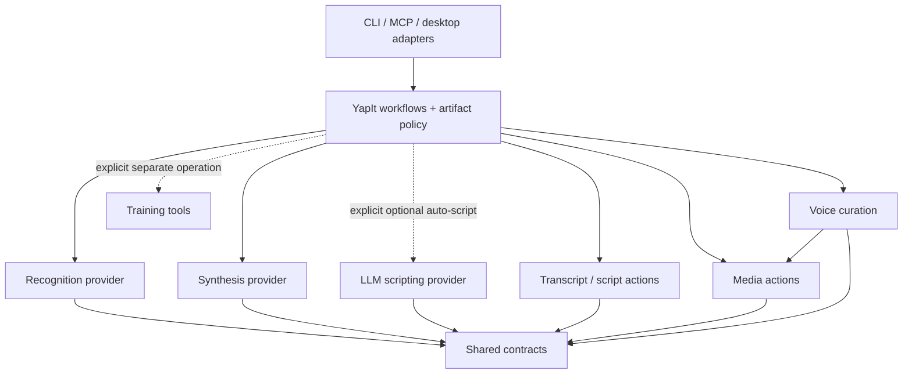
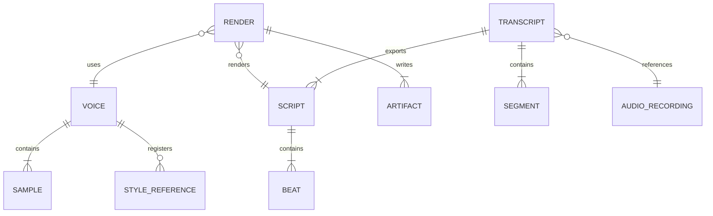

# YapIt library boundaries and dependency plan

Status: proposal for owner review; no module moves or package split implemented.
Inventory date: November 7, 2026. The CosyVoice setup/trial is independent background
work, not a prerequisite for choosing these boundaries.

## Problem Statement

YapIt currently ships one Python distribution with optional speech, transcription,
cloud, MCP and training dependencies. It already has useful backend protocols, but
action logic, model inference, application storage policy and interface code are
not consistently separated. The objective is reusable action-oriented libraries
without making extraction, conversion or transcript formatting depend on an LLM
client, Torch, a particular GPU, or this checkout's directories.
Evidence: `pyproject.toml:5-35`; `src\yapit\speech.py:19-24`;
`src\yapit\rescript\transcription.py:36-40`.

Here, **external LLM access** means a request to a hosted language-model API.
**Local model inference** means running downloaded speech-model weights locally.
ASR (automatic speech recognition) converts spoken audio to text; TTS
(text-to-speech) synthesizes speech from text. A local TTS model can contain a
language-model component without needing OpenAI or another hosted API.
Evidence: `src\yapit\scripts.py:29-71`; `src\yapit\speech.py:31-95`;
`src\yapit\rescript\transcription.py:59-106`.

### Current responsibility map

| Action | Current owner | Hosted LLM/API required? | Current execution and hardware |
|---|---|---|---|
| Extract video audio | `rescript.audio.extract_audio` -> `media.run_media` | No | CPU FFmpeg; first audio stream, mono 24 kHz PCM WAV |
| Convert unsupported audio | The same `extract_audio` function | No | CPU FFmpeg; decodable input becomes supported WAV; corrupt/undecodable/no-audio input errors |
| Copy already-supported audio | The same function, after decode validation | No | CPU filesystem copy; original supported container preserved |
| Recognize spoken words | `WhisperTranscriber.recognize` | No | Local faster-whisper/CTranslate2; configured CPU/int8 or CUDA/float16 |
| Prepare recognition input | `transcribe` | No | CPU FFmpeg decode to temporary mono 16 kHz WAV |
| Compose recognition into narration scripts | `compose_scripts` | No | CPU deterministic partitioning, schema validation and source-gap-derived pauses |
| Load/validate text or Script JSON | `scripts.load_script`, `models.Script` | No | CPU; no model |
| Build a reusable script prompt | `scripts.build_prompt` | No | CPU template/schema/word-budget composition; another tool may subsequently use the prompt |
| Automatically write a script | `scripts.generate_script` | **Yes, when chosen** | OpenAI request with brief and optional sampled image frames; explicitly cloud-gated |
| Enroll/curate a voice or labeled style | `voices`, `enrollment`, `desktop` | No | CPU recording, FFmpeg, NumPy signal checks and profile storage; not training |
| Synthesize the enrolled voice | `speech.QwenSpeech` | No hosted API | Local Qwen model; CPU supported, CUDA preferred for the intended workflow |
| Fit/encode audio | `media.fit_audio`, `encode_mp3` | No | CPU FFmpeg; standard pipeline applies existing duration/stretching gates |
| Build timelines/captions/edit guides | `timeline`, `media.render_guide` | No | CPU NumPy/Pillow/FFmpeg; current guide encoder is `libx264`, not a configured GPU encoder |
| Fine-tune a voice | `training.train` | No hosted LLM API | Current implementation requires Linux/WSL2, CUDA, BF16 and FlashAttention |
| Expose commands/tools/UI | `cli`, `rescript.cli`, `server`, `desktop` | No intrinsically | CPU adapters; called operations determine model/API needs |
| Name/persist artifacts | `storage` | No | CPU filesystem I/O and exclusive name reservation |

Inventory evidence:
`src\yapit\rescript\audio.py:14-103`;
`src\yapit\rescript\transcription.py:40-274`;
`src\yapit\scripts.py:12-71`;
`src\yapit\voices.py:16-251`;
`src\yapit\enrollment.py:103-346`;
`src\yapit\desktop.py:19-51`;
`src\yapit\speech.py:31-95`;
`src\yapit\media.py:18-257`;
`src\yapit\timeline.py:11-68`;
`src\yapit\training.py:16-175`;
`src\yapit\cli.py:23-198`;
`src\yapit\server.py:18-167`;
`src\yapit\storage.py:14-157`.

The supported-copy set is WAV, MP3, M4A, AAC, FLAC, OGG, OPUS, AIF/AIFF and WMA.
Extraction and conversion are currently **one public operation**, not separate
libraries. It always validates by decoding before deciding whether to copy the
original. `src\yapit\rescript\audio.py:14-103`.

### Important distinctions and coupling

1. Providing a script to normal narration does not call OpenAI. `--auto-script`
   is the optional cloud route; `YAPIT_ALLOW_CLOUD=true`, a key and the cloud
   dependency are required. It sends the brief/optional frames, not the voice
   reference recording. `src\yapit\scripts.py:29-71`;
   `src\yapit\pipeline.py:50-108`.
2. Downloading model weights can require internet access even when inference is
   local. A complete local cache and offline settings remove that download step;
   they do not turn local inference into hosted LLM access.
   `src\yapit\speech.py:57-75`;
   `src\yapit\rescript\transcription.py:66-80`.
3. MCP (Model Context Protocol) is an interface, not an LLM provider. This server
   runs over stdio; its client may be an assistant, but deterministic tools do not
   require a model API. Rescript commands are currently CLI/Python operations,
   not registered tools in this MCP server.
   `src\yapit\server.py:18-167`; `src\yapit\rescript\cli.py:16-69`.
4. `media.py` combines audio utilities, image/video sampling and guide rendering.
   `scripts.py` combines deterministic formatting and hosted generation.
   `rescript.transcribe` combines decoding, archiving, inference, composition and
   persistence. `storage` chooses application roots from environment settings.
   These are the principal seams to extract, not reasons to add a microservice.
   `src\yapit\media.py:18-257`; `src\yapit\scripts.py:12-71`;
   `src\yapit\rescript\transcription.py:176-274`;
   `src\yapit\storage.py:84-157`.
5. Source timestamps, delivery pauses, output duration and generation runtime are
   different things. Current composition turns source gaps into `pause_ms`, and
   Pipeline inserts those pauses after model-generated audio. The proposed
   architecture must make that mapping explicit to avoid stacked pauses.
   `src\yapit\rescript\transcription.py:108-134`;
   `src\yapit\pipeline.py:104-134`.

## Implementation

### Recommended boundaries

First establish these logical boundaries in the existing repository. Design
independently installable distributions at the boundaries, but publish/split
packages incrementally rather than creating a large set of empty packages.
This is a proposal, not the current folder layout.

| Logical module / eventual distribution | Responsibility | Dependencies deliberately excluded |
|---|---|---|
| `contracts` / `yapit-contracts` | Typed audio metadata, recognition segments, Script/Beat, voice identity, delivery requests and result/error contracts | Torch, Whisper, OpenAI SDK, CLI/UI, global configuration and filesystem policy |
| `media` / `yapit-media` | Probe, extract, convert, decode, resample, loudness/encoding and optional video/frame/guide operations | ASR, TTS and LLM clients |
| `transcripts` / `yapit-transcripts` | Parse/validate, compose segments into scripts, explicit pause-policy mapping, captions/format export and deterministic prompt composition | Model runtimes and hosted clients |
| `voices` / `yapit-voices` | Consent/profile handling, recording curation and signal-quality checks; recording/UI adapters remain separate | TTS model loading, hosted clients and training |
| `recognition` / initially `yapit-asr-whisper` | Local audio-to-segment inference behind the recognition protocol | Script writing, application folders and hosted text-generation clients |
| `synthesis` / `yapit-tts-qwen`, `yapit-tts-cosyvoice` | Local text/reference/delivery-to-audio adapters behind a synthesis protocol | Source transcription, UI, application storage choices and hosted script generation |
| `llm_scripting` / `yapit-llm-scripting` | Hosted script-writing provider, request policy, structured results and bounded revision | Extraction, conversion, speech-model runtimes and recording management |
| `training` / optional backend-specific tools | Prepare reviewed datasets and run model-specific adaptation | Base-library import/install and normal inference startup |
| `workflows`, `storage`, `apps` / YapIt application | Compose actions; own folders/naming, defaults, permissions, device selection, CLI/MCP/desktop and run status | No direct provider-specific generation logic in entry-point adapters |

New contracts such as a delivery request or audio metadata are proposed, not
existing schema fields. Reuse existing `SpeechBackend` and `TranscriptionBackend`
as starting seams instead of inventing a generic agent framework.
Evidence for feasibility: `src\yapit\speech.py:19-24`;
`src\yapit\rescript\transcription.py:24-40`;
`src\yapit\models.py:13-109`.

Within media, use cohesive `audio`, `video` and `render` modules rather than one
distribution for every verb. Audio-only consumers should not have to install
Pillow/video UI dependencies. A deterministic action that later gains an LLM
assist keeps its deterministic implementation here; the model-assisted part goes
in the LLM provider library and the workflow explicitly composes both.

### Proposed dependency and communication model

**Host adapters:** parse command/tool/UI input and display results. They call
workflows synchronously through Python; MCP receives requests over local stdio.
They do not select a hosted provider implicitly.

**Workflows and artifact policy:** orchestrate extraction, recognition, optional
script writing and synthesis; reserve output names and persist provenance/status.
They call compatible libraries in-process, or model workers through the
subprocess/file bridge described below. Application configuration is resolved here.

**Media actions:** accept explicit source/destination and media settings, then
invoke local FFmpeg subprocesses or NumPy/soundfile/Pillow operations. They return
media metadata/results to the workflow and never call an AI provider.

**Transcript/script actions:** transform supplied text or recognition segments
into validated results through synchronous Python calls. They distinguish source
timestamps from intentionally selected delivery pauses and do not create text via
an undeclared model.

**Voice curation:** validate consent, curate supplied recordings and select an
authorized reference. It calls media actions for decoding; profile persistence
is injected or performed by the application rather than an assumed local folder.

**Recognition provider:** runs the selected local ASR model and returns typed
segments. Device/precision/model location are explicit configuration; its output
does not automatically become a rewritten script.

**Synthesis provider:** consumes approved text, selected identity/reference and
supported delivery settings, returning audio. Its runtime is model-specific.
Unsupported emotion/mode combinations fail rather than being silently ignored.

**LLM scripting provider:** accepts an explicitly permitted brief/optional frames,
calls the configured hosted endpoint synchronously over HTTPS and returns a
validated Script. Keys and network permission are injected by the application;
CPU media operations never acquire this dependency through an import.

**Training tools:** run an explicitly requested backend-specific training worker
with its own prerequisites and reviewed dataset. They communicate via dataset
files, checkpoints and run metadata, not inference startup.

**Shared contracts:** carry typed values/errors across these calls and serialized
worker requests. They perform validation without loading models, discovering
devices, reading `.env`, or creating application directories.

### Model runtimes are not one shared library environment

Keep each provider independently installable. A compatible provider may run
in-process; incompatible dependency/interpreter versions use a local subprocess
worker with a versioned JSON request/result and audio files. Do not merge all
Torch/Transformers pins into the base package. Do not introduce HTTP services,
containers or a distributed broker merely to separate libraries.

The current main distribution requires Python 3.11-3.12. The selected CosyVoice
trial is isolated in Python 3.10 with its upstream dependency pins. This is a
concrete reason to preserve a process boundary, not just a stylistic preference.
`pyproject.toml:10`; `requirements-cosyvoice.txt`;
`scripts\cosyvoice-trial.py` (experimental implementation, inference not yet
validated at inventory time).

### Execution and privacy policy

- CPU handles deterministic operations and host orchestration.
- ASR supports explicit CPU/GPU selection; CUDA is the preferred experiment on
  the connected eGPU, not a mandatory prerequisite for transcription.
- Qwen inference supports CPU or CUDA; choose CPU explicitly while traveling.
  Do not imply that every future TTS backend has an already-tested CPU mode.
- Current fine-tuning retains its Linux/WSL2 + CUDA/BF16/FlashAttention gate.
- Network/model download permission is separate from hosted LLM permission.
- Normal extraction/transcription/narration must work without an OpenAI key.
  No provider may upload private recordings to judge voice or emotion quality.

Existing hardware gates:
`src\yapit\rescript\transcription.py:40-80`;
`src\yapit\speech.py:43-75`; `src\yapit\training.py:27-45`.
The faster-whisper authors document both CPU and GPU inference [R1].

The existing `gpu` mode launcher checks CUDA before dispatching any command,
including CPU-only extraction. That is a launcher policy, not a GPU requirement
of `extract_audio`; CPU mode or the normal CLI can perform extraction without the
eGPU. Reusable libraries should select hardware per model operation rather than
requiring Torch/device discovery for all media actions.
`scripts\run-mode.py:23-56`; `src\yapit\rescript\audio.py:36-103`.

Keep canonical storage/default profile/numeric duplicate handling in YapIt:
`data\audio`, `data\transcripts`, `data\generated_audio`, flat run metadata and
`<profile>.<source>` names with default `arka`. Libraries receive explicit paths;
they must not enforce this particular application's folders or default speaker.
Do not migrate old files or change standard narration duration behavior as a
side effect of package extraction. `src\yapit\storage.py:41-157`;
`src\yapit\pipeline.py:50-164`.

For future `add_emotion`, the proposed composition is media preparation ->
optional ASR -> approved/unreviewed-draft transcript -> identity + delivery request
-> local synthesis -> CPU audio export. A hosted text LLM is **not required**.
The natural-timing policy and whether source gaps are preserved are separate
workflow settings. No automatic word rewriting or speech acceleration is implied.

### Local scale, backpressure and failure points

**Planning estimates, not observed traffic or generation benchmarks:** assume
one owner, twenty 60-second narrations/day, and one admitted model job per minute
at peak: `1 / 60 = 0.0167 jobs/s`. If each completed job performs three logical
input reads and six artifact writes, estimated warm-job rates are `0.05 reads/s`
and `0.10 writes/s`; model loading adds separate large-file reads.

At 24 kHz mono PCM16, one 60-second WAV is `24000 * 2 * 60 = 2.88 MB`.
Keeping raw and final WAV plus a 192 kb/s MP3 gives approximately
`(2 * 2.88 + 192000 / 8 * 60 / 1000000) * 20 * 30 = 4320 MB/month`.
Fitted intermediates, recordings, model weights and training checkpoints are
additional. Current audio format/encoding:
`src\yapit\media.py:16,60-61,117-133`.

The proposed bottleneck is model admission/VRAM, not filesystem request volume.
Keep at most one model-heavy job admitted per local GPU worker initially.
Reject busy requests or use a small bounded local work queue; do not silently
queue unlimited audio in RAM. Current MCP already rejects concurrent protected
operations per server instance, but it does not coordinate independent CLI
processes. `src\yapit\server.py:23,47-61,64-95`.

Single points of failure are the eGPU/driver, local disk, model worker and optional
hosted endpoint. Mitigations are explicit supported CPU selection, checked local
caches/backups, persisted failure status and bounded worker timeouts, and keeping
hosted script generation optional. The VPN can block provisioning independently
of GPU capability. No database or broker is introduced here; CAP classification
of distributed databases/queues is therefore not an applicable selection gate
for these single-host files.

### Existing logical data relationships

This models existing JSON/file relationships, not database-enforced foreign keys.
Do not interpret source timestamps as alignment for a synthesized waveform.

Evidence: `src\yapit\models.py:26-90`;
`src\yapit\pipeline.py:78-164`;
`src\yapit\rescript\transcription.py:242-274`.

## Success Criteria

1. Extraction/conversion and transcript/script formatting install/import without
   Torch, Whisper, OpenAI SDK, CUDA discovery or application-directory creation.
2. A provided script can reach local synthesis with no hosted key/network calls;
   cloud scripting cannot execute without explicit permission.
3. Recognition returns source-timed segments; application composition chooses
   delivery pauses separately. Existing text, timestamps and schema limits remain
   preserved unless the owner approves a particular behavior change.
4. Each selected model backend can be installed in an isolated compatible runtime
   and reports actual model/device/control provenance. CPU unsupported modes and
   absent GPUs produce explicit errors rather than unintended fallback.
5. Current CLI names, MCP contracts and approved filename/storage behavior remain
   compatible through adapters. Existing regression fixtures remain unchanged.
6. Focused contract and offline-install/import tests validate the actual library
   boundaries; listening validates identity/emotion, not dependency routing tests.

## Task Breakdown

These are planning-sized work items, not a delivery commitment. Final package names,
publication timing and the first extraction are subject to owner review.

| Item | Estimate | Prerequisites | Acceptance |
|---|---|---|---|
| 1. Agree boundary/API and timing contracts | 1 week | None | Current vs proposed responsibilities approved; no silent pause/duration/text changes |
| 2. Extract contracts + deterministic media/transcript actions | 1-2 weeks | 1 | CPU-only imports/install; explicit output paths; compatibility adapters and focused tests |
| 3. Isolate hosted script writing | 1 week | 1, 2 | OpenAI dependency and network permission confined to provider; prompt formatting remains model-free |
| 4. Stabilize ASR/TTS provider and worker interfaces | 1-2 weeks | 1, 2 | Whisper/Qwen/Cosy isolated runtimes; device/capability errors, audio validation and provenance |
| 5. Thin application workflows and host adapters | 1-2 weeks | 2, 3, 4 | Storage/defaults/permissions owned by YapIt; existing CLI/MCP behavior preserved |
| 6. Package and release only reusable boundaries | 1 week | 5 | Clean-environment wheel/import smoke tests; separate optional training; no unused public packages |

No source refactor is authorized by writing this proposal. Recommended first step
after review: deterministic contracts/media/transcript extraction, not training
or adding another model.

## Reference Links

- Current install/entry-point boundaries: `pyproject.toml:5-35`.
- Audio extraction/conversion/copy: `src\yapit\rescript\audio.py:14-103`.
- Recognition/preparation/composition/persistence:
  `src\yapit\rescript\transcription.py:24-274`.
- Deterministic vs hosted script generation: `src\yapit\scripts.py:12-71`.
- Local synthesis and protocol: `src\yapit\speech.py:19-95`.
- Media/timeline: `src\yapit\media.py:18-257`; `src\yapit\timeline.py:11-68`.
- Enrollment/reference selection: `src\yapit\voices.py:16-251`;
  `src\yapit\enrollment.py:103-346`.
- Orchestration/storage/hosted permission: `src\yapit\pipeline.py:25-164`;
  `src\yapit\storage.py:14-157`.
- Interfaces: `src\yapit\cli.py:23-198`; `src\yapit\server.py:18-167`;
  `src\yapit\desktop.py:19-51`.
- Training prerequisites: `src\yapit\training.py:16-175`.
- Experimental Cosy runtime: `requirements-cosyvoice.txt`;
  `scripts\cosyvoice-trial.py`. Separate from production backend selection.
- R1. faster-whisper authors, [official CPU/GPU usage and CTranslate2 requirements](https://github.com/SYSTRAN/faster-whisper/blob/master/README.md).
