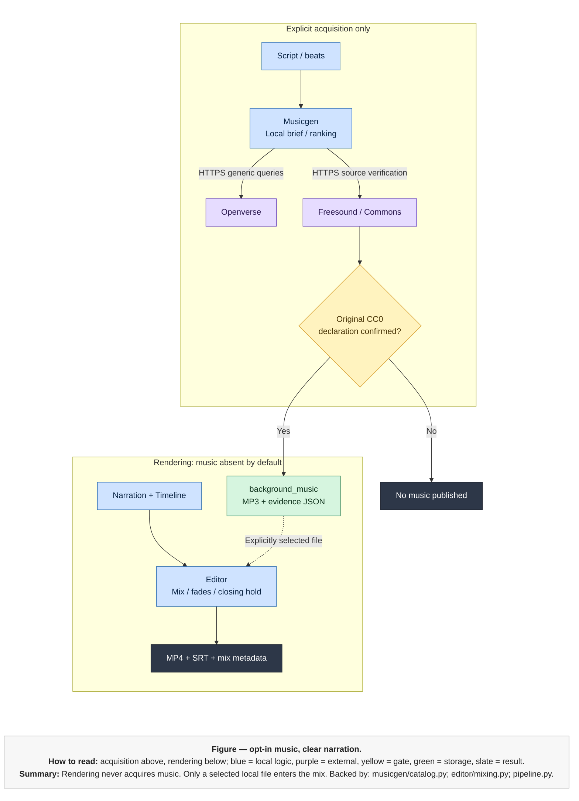
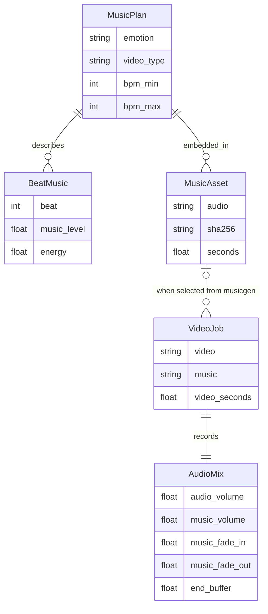

# Optional music acquisition and narration-safe mixing — YapIt

| Field | Value |
|---|---|
| Owner | Arka / YapIt maintainer |
| Status | Implemented; artistic/listening review remains manual |
| Last updated | 2026-11-08 |
| Services in scope | Musicgen, Editor, CLI/Pipeline/MCP, local storage |
| Reviewers | Arka; other reviewers not assigned |

## 1. Problem Statement

**Gap A — music acquisition.** The existing narration/edit-guide workflow did
not acquire background music. The requested addition is script-aware travel
music, not another speech model. The approved scope is CC0 downloads only;
AI music runtime provisioning is deferred. Music remains absent by default.
The application only supplies a track after an explicit file selection.
Sources: user decisions; `src\pipeline.py:57`, `src\musicgen\catalog.py:239`.

**Gap B — narration-safe mixing.** Editor previously mapped narration directly
into the MP4. It now needs independent track gains, music-only fades, smooth
beat-level modulation and speech-driven ducking. Ducking means lowering the
music while actual speech is present, not merely while a caption is visible.
Sources: `src\editor\mixing.py:16`, `src\editor\mixing.py:46`.

**Gap C — slate usability and ending.** Large centered clip/time labels must
remain prominent while a smaller script excerpt sits below center with margins.
The last visual must remain briefly after speech. The default hold is 0.75
seconds, minimum 0.5, rounded up to a video frame.
Sources: user requirements; `src\editor\templates.py`, `src\editor\render.py:13`.

Copyright-free is not synonymous with royalty-free. Accept an original source's
CC0 declaration, retain evidence, and refuse missing/changed/unsupported claims.
This cannot establish every underlying right or eliminate erroneous platform
claims. No legal warranty is offered. Sources:
[CC0](https://creativecommons.org/publicdomain/zero/1.0/legalcode.en),
[Openverse warning](https://docs.openverse.org/terms_of_service.html).
Correctness, privacy and validation gates are not traded for convenience.

This is a local creator application, not an organization service deployment.

| Concerned party | Alias | Oncall | Owner |
|---|---|---|---|
| YapIt maintainer/editorial reviewer | *(fill alias)* | Not assigned | Arka |
| External catalog/source operators | Public API/site support; no internal alias | Not assigned | Not verified |

## 2. Implementation

### Responsibilities and communication

**Backed by:** `src\musicgen\planner.py:31`,
`src\musicgen\catalog.py:149,181,239`, `src\editor\mixing.py:46`,
`src\editor\render.py:13`, `src\pipeline.py:57`.

**Input contracts and application adapters.** Script/Beat and Timeline/Cue carry
reviewed words, visual context and measured timing. CLI/Pipeline/MCP call local
Python functions synchronously; MCP additionally confines file paths. Rendering
does not initiate catalog calls. Sources: `src\models.py`, `src\cli.py`,
`src\pipeline.py:57`, `src\mcp\server.py`.

**Musicgen.** The local planner supplies editable mood, BPM/instrument suggestions
and per-beat levels for nine editorial profiles. It is intentionally
metadata/rule-based, not falsely presented as an audio-understanding model.
The catalog layer makes bounded HTTPS GETs, converts catalog milliseconds to
seconds, rejects obvious non-music/vocals and ranks declared metadata.
Sources: `src\musicgen\planner.py:31`, `src\musicgen\catalog.py:149`.

**Openverse.** This external discovery API returns candidate IDs, source/audio
URLs and license metadata over HTTPS request/response. It is not the final
authority for a track's license. Source:
[API schema](https://api.openverse.org/v1/schema/).

**Freesound / Commons and the license gate.** Musicgen refetches the original
per-track HTML declaration or per-file API metadata synchronously. Freesound's
preview sound ID must match; Commons' audio URL must match its `imageinfo`.
An absent/changed declaration ends acquisition without publishing audio.
Source: `src\musicgen\catalog.py:181`.

**Asset storage.** Local file writes save a normalized stereo MP3 plus source,
license, hash and plan JSON. The song component includes a source ID;
collisions produce a new name. Handled failures clean up only newly owned files.
There is no cross-file transaction. Source: `src\musicgen\catalog.py:239`.

**Editor.** Local Pillow/FFmpeg subprocesses receive narration, measured Timeline
and an optional selected music path. `AudioMix` validates linear 0-100 gains,
music-only fades, looping, speech ducking and smooth per-beat music levels.
The final slate/time/palette include the closing hold; narration Timeline/SRT
remain aligned to speech. Sources: `src\editor\mixing.py:16,46`,
`src\editor\render.py:13`.

**Published result.** Application jobs store MP4/SRT and mix/status metadata;
`seconds` is narration length and `video_seconds` includes the frame-rounded
hold. Existing files are preserved. Source: `src\editor\generation.py:13`.

### Choices and tradeoffs

| Choice | Why chosen / tradeoff |
|---|---|
| CC0 source-checked downloads | Fits the approved licensing scope without model downloads. Smaller catalog and manual artistic review; no universal rights warranty. |
| Openverse discovery plus original-source verification | Broad search without an API key; stale index declarations do not bypass the source gate. Freesound uses its public HQ preview rather than the protected original master. |
| Local, editable music brief | Private narration stays local and defaults work without another LLM. Metadata/rules are limited; human listening is required. |
| Music-only fades and speech sidechain ducking | Protects spoken clarity and responds to actual pauses. One soundtrack is modulated, not abruptly swapped between beats. |
| Separate narration/video durations | Ending hold does not become another inter-sentence pause. The +/-33% video range includes the hold, allowing at most one frame of quantization. |
| No automatic acquisition | Default videos remain music-free and work offline. Selection/download is an explicit additional action. |

Backed by user choices; `src\musicgen\catalog.py:52,181,239`,
`src\musicgen\planner.py:31`, `src\pipeline.py:57`,
`src\editor\mixing.py:46`.

### Scale, RPS, backpressure and single points of failure

These are **sizing estimates**, not production telemetry:

- One local creator; assume 10 reels/day and a library of 100 tracks.
- At 120 seconds/track and 192 kbps, library storage is
  `100 * 120 * 192000 / 8 = 288 MB`, plus JSON and temporary files.
- If every reel acquires a new track, growth is `10 * 2.88 = 28.8 MB/day`.
  Assume one selected hot track and 99 cold files; no remote cache is involved.
- Assume one active operation starts per minute: `1 / 60 = 0.0167` job RPS.
  Search performs at most three catalog requests: `3 / 60 = 0.05` catalog RPS.
  A selected download makes one detail, one source and one media request.
- Metadata is bounded to 2 MiB and music downloads to 64 MiB; buffered download
  copying can transiently consume about 128 MiB before media-processing buffers.
  These are implementation bounds, not typical observed use.
- Each socket has a 20-second timeout and an elapsed deadline check; FFmpeg
  preparation has a 180-second subprocess timeout. Slow/rate-limited providers
  fail explicitly, rather than starting an unbounded retry/background queue.

Sources: `src\musicgen\catalog.py:52,149,239`. Upstream quotas can change;
the API returns throttling errors. No paid backend, distributed scheduler,
telemetry dashboard, cache hit-rate guarantee or GPU runtime is introduced.

| SPOF / backpressure point | Blast radius | Mitigation / limitation |
|---|---|---|
| Catalog or original source unavailable | New search/download blocked | Existing selected local tracks and default no-music rendering remain usable |
| One local disk | Assets/metadata may be lost or unavailable | Exclusive publication, atomic JSON and backups under the owner's control; no replication |
| CPU/FFmpeg process | One render/normalization fails | Bounded subprocess, explicit failure status, no final-file overwrite |
| Concurrent music writers | Name collisions / disk load | Exclusive file creation; no durable global job queue or cross-process media lock |

Sources: `src\musicgen\catalog.py:239`, `src\editor\generation.py:13`,
`src\common_utils\fileutils.py`, `src\mcp\server.py`.

### Data model and storage

**Backed by:** `src\musicgen\models.py:19,27`,
`src\musicgen\catalog.py:239`, `src\editor\mixing.py:16`,
`src\editor\generation.py:13`. These are embedded JSON/application associations,
not database foreign keys. Manually supplied music need not be a Musicgen asset.

<table>
  <thead><tr><th>StorageTypeName</th><th>UseCases</th></tr></thead>
  <tbody>
    <tr style="background-color:#90EE90;color:#000000">
      <td>Local filesystem / JSON (single-node CA shorthand)</td>
      <td>Music, licensing evidence and video/mix metadata; chosen for one-machine editing and existing storage patterns. Not a distributed CAP or durability guarantee; a disk/process failure can block access.</td>
    </tr>
  </tbody>
</table>

Legend: Light-Green = CA; Light-Yellow = AP; Light-Red = CP.
C = consistency, A = availability, P = partition tolerance.
No database or broker is added. Source: `src\storage.py`,
`src\common_utils\fileutils.py`, `src\musicgen\catalog.py:239`.

## 3. Success Criteria

| Feature / guardrail | Baseline | Target / check |
|---|---|---|
| Default music | Previously absent | Still absent; no planner/search/download calls in default rendering |
| Source evidence | No music workflow | Original-source CC0 declaration and matching audio identity before publication |
| Track naming | No shared music directory | Emotion/video-type/song-or-ID stem under `data\background_music` |
| Narration clarity | Direct narration mapping | Fades affect music only; measured music reduction during speech and recovery during pause |
| Beat dynamics | None | Smooth music gain changes, unchanged narration gain |
| Ending | Video ended with narration | At least 0.5 seconds after speech; default 0.75, frame-rounded upward |
| Slate text | Clip/time only | Below-center wrapped excerpt with margins; centered large labels retained |
| Failure/privacy | Existing isolated workflows | No overwrite, no partial asset on handled failures, no private narration/profile egress |
| Artistic fit | Unmeasured | Candidate preview and human listening; no automatic quality approval |

Sources: module tests under `src\musicgen\tests`, `src\editor\tests`,
root Pipeline/interface/storage tests and MCP tests.
Exit requires targeted tests/lint/package checks, an actual CC0 source/download
check and a refreshed no-music reel. Training tests and retraining are outside
scope. Listening quality remains explicitly pending human review.

## 4. Task Breakdown

The initial implementation is local and small; the following are similar
**estimated 1-2 week hardening/review work packages**, not claims of elapsed work:

1. **MG-1 — curate and harden CC0 acquisition** (Gap A): review travel candidates,
   source-verifier edge cases and provider failure behavior; collect listening
   feedback. Initial module/tests are implemented.
2. **ED-1 — review mix/layout/ending quality** (Gaps B/C): listen across real
   narration styles, tune defaults with owner feedback, verify beat dynamics,
   small slates and closing holds. Initial mixer/layout/tests are implemented.
3. **INT-1 — integration and release review** (all gaps; depends on MG-1/ED-1):
   validate packaged imports, CLI/MCP contracts, documentation and privacy;
   obtain owner review before release. No cloud or AI runtime setup is implicit.

## 5. Reference Links

- [Musicgen usage](README.md) and [developer API](dev.readme.md).
- [Editor usage](../editor/README.md) and [developer guide](../editor/dev.readme.md).
- Code: `src\musicgen\planner.py:31`, `catalog.py:52,149,181,239`,
  `models.py:19,27`; `src\editor\mixing.py:16,46`, `render.py:13`,
  `generation.py:13`; `src\pipeline.py:57`; `src\storage.py:92`.
- [Openverse API schema](https://api.openverse.org/v1/schema/) and
  [license-accuracy warning](https://docs.openverse.org/terms_of_service.html).
- [Freesound API/authentication](https://freesound.org/docs/api/authentication.html).
- [CC0 legal terms](https://creativecommons.org/publicdomain/zero/1.0/legalcode.en).
- [FFmpeg filters](https://ffmpeg.org/ffmpeg-filters.html): `afade`,
  `sidechaincompress`, `volume`, `amix`, `apad`, `alimiter`.
- [Meta MusicGen model card](https://facebookresearch.github.io/audiocraft/model_cards/MUSICGEN_MODEL_CARD.html):
  its non-commercial weights are not used here.
- No production dashboard, company oncall, release PR or independent legal
  review is verified. Listening/release review artifacts belong to MG-1/ED-1/INT-1.
