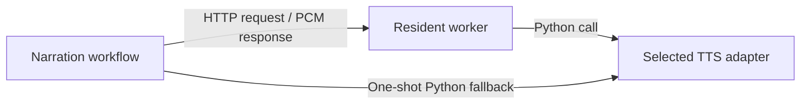
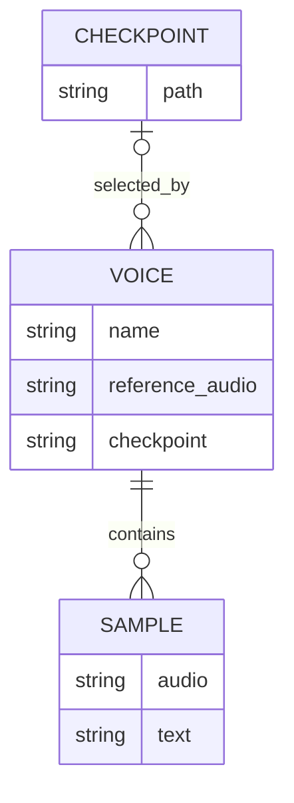

# TTS Training and Backend Selection

| Field | Value |
|---|---|
| Owner | Repository owner |
| Status | Backend selection implemented and unit-tested; training improvements proposed |
| Last updated | 2026-11-08 |
| Services in scope | Yapper, resident worker, training, voice profiles |
| Reviewers | Not assigned |

**Conclusion:** Qwen loading is already improved and backend selection is now
explicit and adapter-based. Training is not proven optimal. Keep the selected
Qwen checkpoint as the baseline; compare reference-based Pocket TTS cloning
only during a separately authorized run before investing in more fine-tuning.
No models were loaded, trained or downloaded during the assessment. A later
authorized Pocket CPU generation produced a 50.30-second Puerto Princesa edit
guide; video/signal checks passed, but cross-model listening remains outstanding.
Source: `workspace\outputs\arka.puerto_princesa.pocket_2026_10.3.status.json`.

## 1. Problem Statement

The actual Arka run used Qwen 0.6B Base, three epochs, batch size one, learning
rate `2e-6`, 15 training clips and one held-out clip. These are recorded settings,
not guesses from CLI defaults. The holdout is reserved but the wrapper does not
evaluate it automatically. Training efficiency and voice quality therefore need
separate measurements. Sources: `workspace\outputs\arka.training.training.json`;
`src\training\trainer.py:97-106,130-139,187-204`.

The existing implementation followed the official single-speaker training
recipe and added a smaller-model projection compatibility hook. It uses model
weight fine-tuning, not lightweight adapters; continuation starts a new AdamW
optimizer rather than restoring optimizer state. Sources:
`src\training\sft_runner.py:10-36`;
`src\training\trainer.py:109-140`; [S1].

| Gap | Verified issue |
|---|---|
| A | The official trainer copies the Base directory and exports model weights every epoch. The wrapper prepares codec data again for every run. This creates avoidable work; its share of training time is unmeasured. [S1]; `src\training\trainer.py:142-185`. |
| B | Resolved for managed inference: `ModelBackend` exposes public lifecycle/identity methods; the worker no longer inspects Qwen/Torch internals. `src\yapper\backends.py:19-28`; `src\yapper\worker.py` (`SpeechEngine`). |
| C | Resolved for inference selection: explicit backend/model settings and adapter cache identities replace Qwen assumptions. Training/checkpoint validation remains Qwen-specific. `src\yapper\backends.py:31-94`; `src\yapper\speech.py` (`QwenSpeech`); `src\training\checkpoints.py:14-31`. |
| D | Deleting older checkpoints was a local cleanup, not automatic retention. The training wrapper still returns every saved epoch. Latest also does not imply best voice quality. `src\training\trainer.py:187-204`. |

Preserve bounded audio, path confinement, sampling behavior, serialization,
failure cleanup and listening review. Routine checks remain mocked units; do not
run inference or training merely to validate refactoring. No additional owning
teams or on-call services are established for this local repository.

## 2. Implementation

### Keep the useful existing loading behavior

The resident worker retains one model and reuses exact-text audio. Qwen uses
BF16 when supported, SDPA and the codebook CUDA-graph adapter. The controlled
benchmark improved uncached synthesis from 33.65s to 10.10s, with the same waveform
hash. Cold model startup remains separate: the last observed worker load was
60.34s including SDK startup. These do not establish an optimal implementation
or a universal realtime guarantee. Sources: `src\yapper\speech.py:55-103`;
`src\yapper\worker.py:165-255`; session artifact
`files\4070-cuda-graph-benchmark.json`; observed `voice-worker-status`.

`load_model` shares the disk cache; it is not an in-memory model registry.
Switching incompatible weights still requires loading them. Keeping a shared
base plus a small voice state can make reference cloning cheaper than a full
checkpoint per voice, but cannot preserve arbitrary fine-tuned changes.
Sources: `src\common_utils\modelutils.py:14-25`; [S2, S3].

### Reduce training work before changing the optimizer

1. Reuse prepared codec data across runs when audio, transcript, reference,
   tokenizer revision and preprocessing code are unchanged. Keep the deterministic
   holdout separate. Current preparation already runs once per run, not per epoch.
   Source: `src\training\trainer.py:90-106,142-170`.
2. Export into a temporary checkpoint directory and publish only after validation.
   Do not copy Base model weights just to overwrite them. Reuse immutable
   tokenizer/codec assets where possible; hard links require the same filesystem
   and must never allow training to modify shared cached assets.
   Sources: [S1]; `src\training\checkpoints.py:45-50,84-103`.
3. Keep the latest validated, selected checkpoint per profile/model after successful
   promotion. Do not delete the existing selected checkpoint during a failed or
   incomplete save. Compare numeric epoch numbers, not filename ordering.
   Sources: `src\training\checkpoints.py:25-31`;
   `src\training\trainer.py:187-204`; owner's latest-only retention requirement.
4. Measure data preparation, optimization and export independently. Batch size
   one is not necessarily fastest, but increasing it changes training behavior
   and memory use. The upstream accumulation factor is four. With the recorded
   15 clips, three epochs mean approximately 45 minibatches and 12 optimizer
   updates, assuming every record is accepted and the final partial batch is
   synchronized. Sources: recorded training JSON; [S1].
5. Consider cached speaker conditioning only after verifying a frozen,
   deterministic encoder/reference path. The current upstream recomputes detached
   reference embeddings per batch; caching must not silently remove augmentation
   or change conditioning. Parameter-efficient training would need a separate,
   verified recipe: it is not implemented or proven faster here. [S1].

First compare no-training reference cloning with the selected fine-tuned voice.
It avoids optimization entirely, but voice similarity may be worse. Do not
retrain merely because the wrapper can support a different model.

### Lighter alternatives

Sizes and performance claims below are upstream descriptions, not local benchmarks.

| Candidate | Size | Fit for Arka |
|---|---|---|
| Pocket TTS standard English | About 100M parameters | First comparison candidate: CPU-oriented reference cloning, reusable exported voice state and published training code. A recording can condition the voice without fine-tuning. [S2, S3, S4]. |
| Pocket TTS small English | 18.2M, 6.9M, 1.9M, including decoder | Released October 2026. Worth a later speed/identity comparison; the 1.9M release is experimental. Smaller does not guarantee acceptable identity or faithful wording. [S2, S5]. |
| Chatterbox Nano / Turbo | 110M / 350M | Support reference-audio cloning, but the official repository now states that maintenance ended in August 2026. Not the preferred new dependency. [S6]. |

The Pocket training quickstart demonstrates training on 200 hours, not a
drop-in few-minute Arka fine-tuning recipe. Its useful first route here is
reference conditioning. None of these models can load Qwen checkpoint tensors.
Sources: [S3, S4, S6]; current Qwen-specific validation in
`src\training\checkpoints.py:14-22`.

### Minimal interchangeable backend boundary

**Implemented:** a small lazy factory is keyed by backend name, with built-in
Qwen/Pocket adapters, trusted local registration and installed `yapit.tts`
plugins. Model selection is separate from voice selection: a profile can retain its Qwen
checkpoint while another binding uses its reference recording or exported voice
state. Never silently pass the Qwen checkpoint to another architecture.

The worker-facing contract covers public load, synthesis, close and
metadata/identity methods. Adapters own SDK imports, native sample rates,
device handling and capabilities; they return the existing validated mono
24 kHz PCM contract. The worker does not inspect Torch model internals.
Sources: `src\yapper\backends.py:19-28,73-94,112-120`;
`src\yapper\generation.py` (`render_audio`);
`src\yapper\worker.py` (`SpeechEngine`).

Backend/model identity controls loading; voice-conditioning identity controls
voice-state reuse. Backend version, selected model, voice state and effective
request settings enter the audio-cache key. Asset stamps detect local changes,
but custom Pocket YAML does not stamp every referenced weight: use immutable
revisions and restart after changing those weights. Sharing base weights across
different profiles remains a future optimization. Qwen-specific acceleration stays
inside the Qwen adapter. Training remains a separate capability: support for
inference does not imply compatible training or resumable checkpoints.
Sources: `src\yapper\worker.py:132-206`;
`src\yapper\speech.py:92-103`; `src\training\trainer.py:29-52`; [S3].

Audiogen and voice-worker expose `--backend` and `--model`. Qwen remains the
compatibility default; other routes can use the worker's startup selection or
`YAPIT_TTS_BACKEND` / `YAPIT_TTS_MODEL`. Dependency errors are explicit.
Keep optional backends in separate environments when their
requirements conflict. CosyVoice currently exists only as a standalone trial,
not a production-selectable Yapper adapter.
Sources: `src\yapper\cli.py`; `src\cli.py` (`voice_worker`);
`src\yapper\backends.py:57-70`; `scripts\cosyvoice-trial.py:25-47,97-147`.

Agent-selected models must be verified latest appropriate stable releases from
2026 or later. Pocket defaults to the dated `english_2026-10` model, supported
by stable SDK v4.0.1 (October 21, 2026). The official Qwen 0.6B Base revision
`5d83992436eae1d760afd27aff78a71d676296fc` matches the recorded training Base
snapshot; its Hub last-modified date is January 29, 2026. Sources: [S2, S7, S8];
recorded training JSON. User-supplied plugins/model IDs are not automatically
release-date validated. Existing checkpoints are preserved, not automatically
upgraded. A worker started before these changes must be restarted to accept
explicit selectors; incompatible legacy workers reject them rather than ignore them.
Source: `src\yapper\worker.py` (`WorkerSpeech`).

### Current communication and logical data model

Backed by: `src\yapper\generation.py:59-66`;
`src\yapper\worker.py:86-128,165-205`.

**Narration workflow:** joins speech, fits/encodes audio and publishes its
timeline; calls the local worker synchronously through `WorkerSpeech`, or an
in-process fallback adapter. `src\yapper\generation.py:59-115`.

**Resident worker:** accepts authenticated loopback HTTP, serializes synthesis,
owns model residency/cache and returns PCM; calls the speech adapter in-process.
`src\yapper\worker.py:86-128,194-268`.

**Selected TTS adapter:** Qwen loads its SDK/checkpoint and optional reference
conditioning; Pocket loads its SDK and reusable reference/voice state. Both
synthesize/resample through synchronous SDK calls. Installed plugins implement
the same public contract. `src\yapper\speech.py` (`QwenSpeech`);
`src\yapper\pocket.py:14-73`; `src\yapper\backends.py:19-28,73-94`.

Backed by: `src\models.py:64-66,80-91`;
`src\training\checkpoints.py:14-31`. This is a logical filesystem model,
not a database schema. Adapter selection does not convert Qwen checkpoints
into another architecture's weights.

### Scale, pressure and failure boundaries

Observed scope: one active Arka voice/model and 16 clips; recorded training used
15 targets. The retained checkpoint occupies about 2.33 GiB. Keeping three such
epoch exports is approximately `3 * 2.33 = 6.99 GiB`, versus one 2.33 GiB export;
shared Hub/LFS caches and temporary training files are additional storage.
Sources: recorded training JSON; inspected checkpoint directory file lengths.

Controlled warm service-time capacity is approximately `1 / 10.10 = 0.099`
requests/s for the benchmark's 7.52-second chunk, excluding client overhead.
This is an estimate from one sample, not peak throughput. The worker permits one
active request and rejects concurrent work; preserve that bounded pressure policy
rather than loading duplicate GPU models. Model switching and checkpoint export
are separate load/disk-pressure areas.
Sources: benchmark artifact; `src\yapper\worker.py:194-203`.

The unreplicated worker/GPU is a single point of failure for synthesis; explicit
unavailable/busy errors and authenticated restart are its current mitigation,
not transparent failover. Local checkpoint/cache storage is another failure
boundary: validate complete checkpoint exports before profile promotion.
Sources: `src\yapper\worker.py:58-83,194-268`;
`src\training\checkpoints.py:14-31`.

No new database or queue is proposed. CAP classifications concern distributed
storage partitions and are not an appropriate label for this local filesystem.

## 3. Success Criteria

| Check | Baseline | Exit criterion |
|---|---|---|
| Backend selection | Production defaults and worker assume Qwen | Select Qwen/Pocket by explicit settings; mock both worker and one-shot routes |
| Loading | Last observed cold Qwen startup 60.34s | Separate load from synthesis metrics; no reload on unchanged model identity |
| Audio cache | Qwen-specific model/reference identity | Different backend, weights or conditioning never reuse incompatible audio |
| Training | 15 targets, three epochs, full-weight recipe | Measure each stage; reuse unchanged prepared data; validate before retaining only latest |
| Voice fidelity | No Pocket comparison on Arka | Later authorized same-text listening/transcript comparison; do not assume smaller is better |
| Compatibility | Existing Qwen behavior | Preserve default voice, waveform validation and existing targeted unit behavior |

Backend selection and the Pocket adapter are implemented and mocked-unit tested;
training improvements and cross-model performance comparisons are not complete.
Routine implementation checks must be fast mocked units. Real model tests
and training require a separate explicit run decision.

## 4. Task Breakdown

These are bounded implementation packages, each estimated at up to 1-2 weeks
including review; estimates are not promises of coding time.

| ID | Deliverable | Dependency |
|---|---|---|
| TTS-1 | Implemented: backend factory/public lifecycle, selection plumbing, cache identities and Qwen compatibility units (B/C) | None |
| TTS-2 | Implemented: Pocket reference-cloning adapter, reusable voice state and mocked units; real comparison still pending authorization | TTS-1 |
| TTS-3 | Reusable training data preparation, measured stage boundaries and atomic latest-only checkpoint promotion (A/D) | None; remain Qwen-specific initially |

Do not combine backend integration with timing/prosody default changes or an
unmeasured replacement training recipe.

## 5. Reference Links

Local source references are included beside their findings. Historical training
status lists all original epochs; current profile/filesystem determine what still
exists after cleanup.

- [S1] Official Qwen trainer at the recorded revision:
  `https://github.com/QwenLM/Qwen3-TTS/blob/022e286b98fbec7e1e916cb940cdf532cd9f488e/finetuning/sft_12hz.py`.
- [S2] Current Pocket TTS features and model sizes:
  `https://github.com/kyutai-labs/pocket-tts/blob/main/README.md`.
- [S3] Exporting/reusing a Pocket voice state:
  `https://github.com/kyutai-labs/pocket-tts/blob/main/docs/CLI%20Commands/export_voice.md`.
- [S4] Pocket training scope:
  `https://github.com/kyutai-labs/pocket-tts/tree/main/training`.
- [S5] Pocket small-model release notes:
  `https://github.com/kyutai-labs/pocket-tts/releases`.
- [S6] Current Chatterbox sizes, cloning examples and maintenance notice:
  `https://github.com/resemble-ai/chatterbox/blob/master/README.md`.
- [S7] Latest stable Pocket SDK release and supported selectors:
  `https://github.com/kyutai-labs/pocket-tts/releases/latest`;
  `https://github.com/kyutai-labs/pocket-tts/blob/v4.0.1/pocket_tts/models/tts_model.py`.
- [S8] Current official Qwen Base model metadata:
  `https://huggingface.co/api/models/Qwen/Qwen3-TTS-12Hz-0.6B-Base`.
- Local performance evidence: session
  `files\4070-cuda-graph-benchmark.json`; prior authenticated worker health output.
- Missing evidence: per-stage training timings, Pocket results on this Windows
  machine, and held-out voice comparisons. Gather only during authorized runs.
